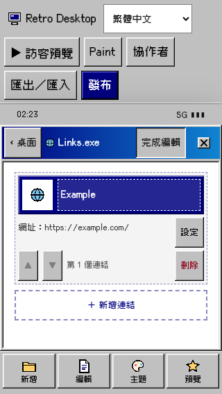
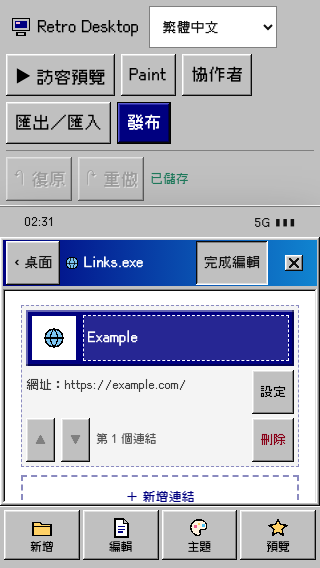
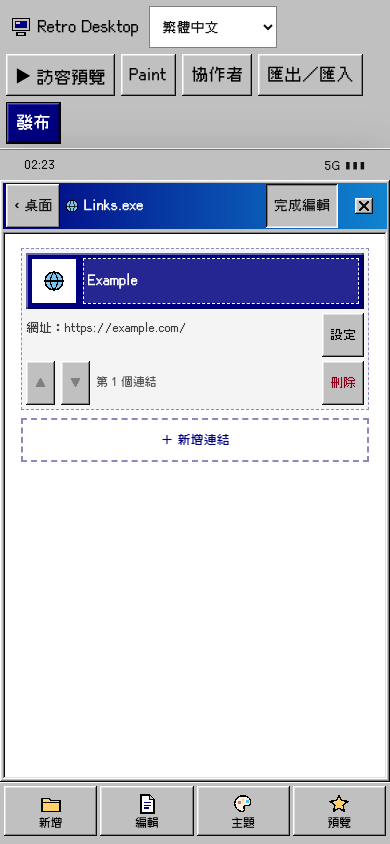
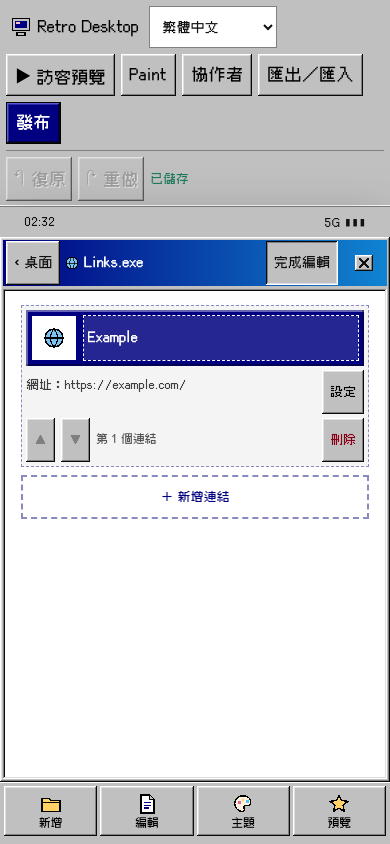
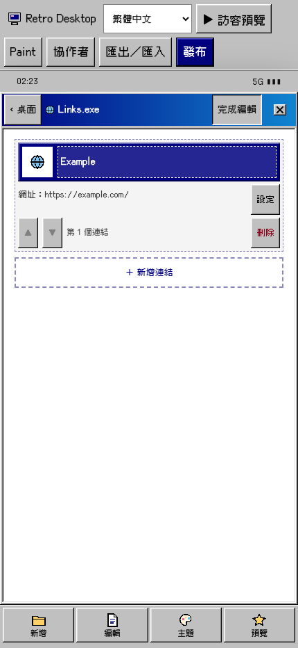
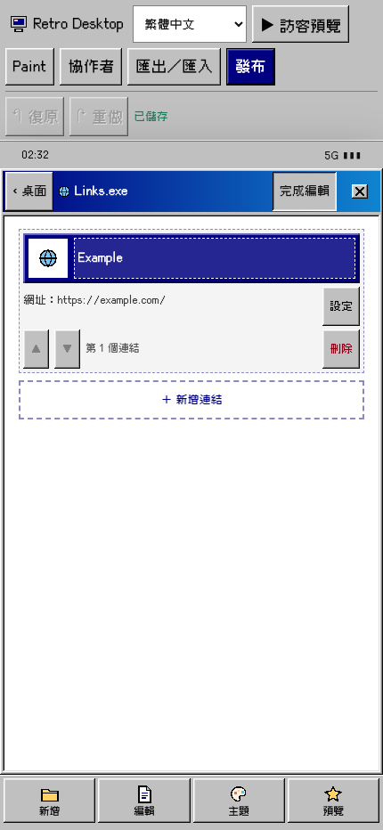
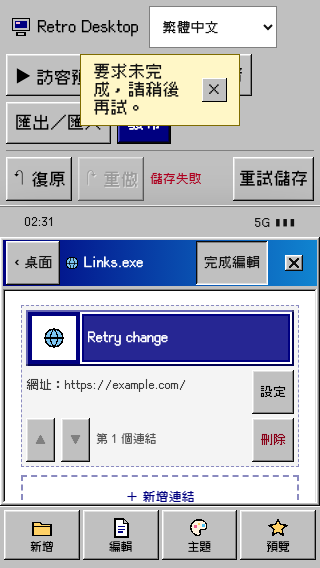
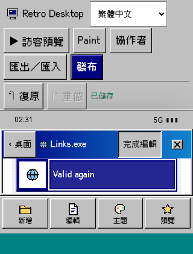

# Mobile history and save feedback

Base: `f11ad8d5cb869d47849834cdd8a692a5059d8021` (freshly fetched main).

Mobile users could delete content while Undo, Redo, and normal save status were hidden. The existing controls now occupy a compact row below primary actions at widths below 768px. Undo/Redo preserve their history-derived disabled states; Retry preserves conflict/upgrade exclusions and calls the existing save mechanism. Status remains a single atomic `role="status"` region. Composition displays the existing incomplete-input message instead of claiming the input is saved, with save errors taking priority.

The change does not introduce a history stack or save system. Runtime hunks are limited to `EditorPage.tsx`'s saveText/toolbar and scoped `w98.css` rules. At viewport heights at or below 500px, toolbar spacing tightens while recovery targets remain 44px. A scoped override removes the obsolete floating-action scroll gap from mobile editor content at those heights so the focused field can be scrolled fully into view.

## Screenshots

Localhost fixtures, Chromium, Traditional Chinese UI. Before screenshots were captured from unmodified runtime source at the base SHA. After screenshots were captured with the final runtime source, dedicated port 54951, and server reuse disabled.

| Width | Before | After |
| --- | --- | --- |
| 320 |  |  |
| 390 |  |  |
| 430 |  |  |

Additional evidence at each width: `evidence/after/saving-*.png`, `error-*.png`, `deleted-saved-*.png`, and `keyboard-viewport-*.png`.

| Save error and retry, 320px | Reduced viewport, 320 × 420px with 34px safe area |
| --- | --- |
|  |  |

## Validation

- Original runtime: the new 320px regression fails because Undo is missing from the mobile accessibility tree. Three initial baseline runs captured screenshots only; they are not counted as regression passes.
- Final runtime: **9/9 focused browser tests pass**, covering touch delete → undo → redo and the resulting saved canonical payload; empty history; unsaved/saving/saved; edits during a delayed request; failure and retry; Enter/Space/Tab; invalid required input and composition; 320/390/430px bounds, 44px recovery targets, and a 420px-height viewport with a simulated safe area and full field visibility after scrolling. See [focused output](evidence/focused-tests.txt).
- History/local-work Vitest: **10/10 pass**.
- Web typecheck and production build: **pass**. Build reports its existing large-chunk warning.
- Existing editor-layout, editor-save-session, and mobile-shell suites: **74/74 pass**; results in [regression output](evidence/regression-tests.txt).

Reproduce with locked dependencies installed, using an available dedicated port:

```sh
CI=1 PLAYWRIGHT_PORT=54951 pnpm exec playwright test tests/e2e/mobile-history-status.spec.ts --workers=1 --retries=0 --reporter=list
CI=1 PLAYWRIGHT_PORT=54952 pnpm exec playwright test tests/e2e/editor-save-session.spec.ts tests/e2e/editor-layout.spec.ts tests/e2e/mobile-shell.spec.ts --workers=2 --retries=0 --reporter=list
pnpm --filter @retrodesk/web exec vitest run src/features/editor/store.test.ts src/features/editor/editorLocalWork.test.ts
pnpm --filter @retrodesk/web typecheck
pnpm --filter @retrodesk/web build
```

Set `HISTORY_CAPTURE_DIR` to a separate directory to capture after screenshots. `CI=1` prevents Playwright from silently reusing a different worker's server. One intermediate run encountered another worker on port 5326 and was discarded; final verification uses fresh servers on 54951/54952.

## Limits and integration notes

This validates Chromium localhost fixtures, not live persistence, physical-device soft keyboards/IME, screen readers, every locale, or the full release gate. Reduced viewport and composition events simulate the relevant constraints. The fixture blocks non-local network requests.

Status reports existing canonical save/validation state and page composition. Module-local buffers that are not yet reflected in those states (notably the separately assigned IG draft-retention work) are not newly registered by this patch. Coordinate that integration if module-local pending input must override canonical saved status. No IG, dialog-focus, Image-gate, API/schema/security configuration, publishing behavior, telemetry, or tutorial changes are included.
