RETRO · PRODUCT UX REVIEW · 2026-10-19 UTC

# Retro 全元件 UI/UX 審核

> 此報告屬於 2026-10-19 的版本快照：完整基準 `8e2e542`，關鍵補驗 `f11ad8d`。本次交付沒有重跑審核。原始完整執行帳留在審核工作區，本 PR 只保留結果摘要、機器可讀清冊及 11 張合成 fixture 截圖。本文的工作批次狀態也以當次交接為準。

## 先讓編輯與復原直覺，再教剩下的複雜性

桌面與手機 UI/UX 審核、互動替代方案與可測驗收。這是審核／設計交付物，不是發布許可或功能完成聲明。

**最優先：**手機復原與儲存回饋、IG 未完成輸入保留、正確的對話框焦點／關層。IG 接著改為「先選任務、選一筆、專心編輯」，把角色管理、篩選與進階欄位從主要工作路徑移開。現有 Gallery、Document、Music 的逐項編輯與媒體復原可沿用。

**完整審核基準：**main `8e2e54241ecca4c79cb5d6190e7b4b0beb804075`。以獨立 `retro-audit` worktree／loopback 5314 檢查；Paint 另以 #122 `7342aca87e00f5718e10100cda118c26bc8392fe`／5315 檢查。沒有更改產品 runtime、schema 或 feature flags，沒有 merge、deploy、外部留言或 staging bypass。

**完整的是程式碼清冊，互動覆蓋是明示範圍。**registry 12 個元件、8 個具名路由模式＋wildcard；11 個可建立元件、1 個受限 image reader/writer。每個可建立元件與 image reader 都做過1440/320/390/430px本機畫面流程，但這不表示每個欄位、每種錯誤與每個瀏覽器都完整驗收。[`apps/web/src/features/modules/registry.ts:26`](https://github.com/laiw54724-ui/retro/blob/8e2e54241ecca4c79cb5d6190e7b4b0beb804075/apps/web/src/features/modules/registry.ts#L26) · [`apps/web/src/app/App.tsx:44`](https://github.com/laiw54724-ui/retro/blob/8e2e54241ecca4c79cb5d6190e7b4b0beb804075/apps/web/src/app/App.tsx#L44) · [機器衍生清冊（含88個export元件檔案）](code-inventory.json)

可用與已發布分開：單張圖片 reader 在 main 可讀既有文件；一般作者新增／來源編輯仍被既有 gate 關閉。Paint 正式入口與新相簿儲存由 #122 提供，於18:05 UTC隨 #127 合併至main。本次沒有放行任何 gate，也沒有給無根據的完成日期。
**版本更新（2026-10-19 18:16 UTC）：**最新main是 `f11ad8d5cb869d47849834cdd8a692a5059d8021`，#127於18:05:34 UTC合併，包含#120–126來源。本輪在同一自有worktree切換到新SHA後，用獨立證據目錄補跑15個IG／手機／modal／數值／setup觀察流程；F01–F10的關鍵問題仍存在。F11/F12以來源比對維持原設計判斷，不冒稱全suite在新SHA重跑。主清冊 registry/routes 未變。版本與補驗摘要見下方執行帳。

<a id="ig"></a>

## IG：可立即採用的任務流程

已獨立重現原始問題，沒有使用別人的 worktree。初步方向已交接給實作工作線。

| 方案 | 優點／代價 | 決定 |
| --- | --- | --- |
| 既有分類＋清單→單項編輯 | 保留可辨識的分類；手機只處理一個物件；可重用既有canonical操作與media queue。需明確保存UI／草稿狀態。 | 推薦；優先切小批實作 |
| 固定寬側欄＋永遠並排preview | 大桌面比對便利，但420px視窗與手機裝不下；會出現第二套布局和狀態同步。 | 只可作寬螢幕增強，不作基本流程 |
| 每次新增／編輯都用wizard或彈窗 | 短期看起來簡化，但更多關閉／草稿／focus邊界；現有modal問題會放大。 | 不採為預設，也不做強制tour |

- **進入：**顯示目前編輯角色與目前任務。角色管理收成一個入口；角色選取和「此視窗首頁角色」明確分開。若這一批尚未拆狀態，先以真實「入口角色」標示現有寫入動作。
- **貼文清單：**一個「新增貼文」、一行搜尋、可展開篩選，接著立刻是縮圖／標題／草稿或公開狀態。沒有搜尋需求時不先看到整組篩選控制。
- **編輯一篇：**「返回貼文」＋這一篇的標題、文字、媒體。可選一張查看更換／替代文字／裁切；保留明確排序鈕。地點、日期、世界觀日期、虛構互動放次要分組。不要為簡化UI而更動post/media的stable IDs或儲存契約。
- **新增：**點新增後選圖片檔案／網址，立刻建立可辨識的草稿目標；逐檔成功保留、逐檔失敗可重試／取消，延遲回應仍綁原site/profile/post。優先接 #124 現有能力。
- **精選／合集：**先在「精選故事」與「貼文合集」中選任務，各自清單→編輯。前者是多頁故事與封面，後者是既有貼文的有序群組；一次只顯示一個編輯任務。
- **預覽與返回：**預覽正在編輯的角色／貼文；返回同一欄位、選取與捲動。局部預覽與整站「發布後會看到什麼」需使用清楚名稱。公開/草稿狀態不要以「已發布」誤指尚未發布的本地編輯。
- **完成：**先處理有效與無效的本地草稿，成功後才退出；提供Undo。分類切換、角色切換與不影響資料的預覽不應要求儲存確認，也不應產生Undo步驟。

**不變條件：**一個資料物件只用一條現有canonical更新路徑；上傳工作仍有原始擁有者；未完成欄位不能因 hide/unmount、重排或跨角色而消失；filter/scroll/selected state留在本地。第一批版面調整不能順手重寫 queue、schema 或網站發布機制。

[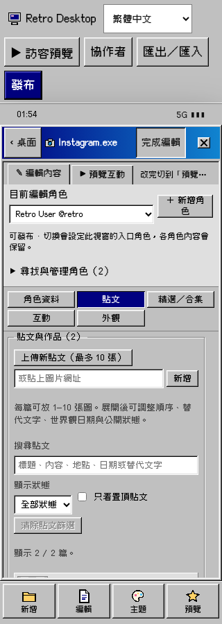](evidence/ig-posts-320.png)

IG 320×900：第一筆貼文幾乎完全落在底部工具列下方 — 點圖開啟原尺寸

[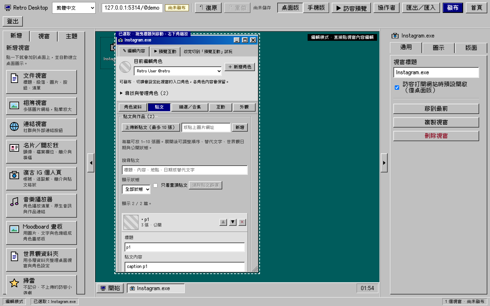](evidence/ig-posts-1440.png)

IG 桌面：管理和篩選佔掉預設編輯視窗的大半高度 — 點圖開啟原尺寸

<a id="findings"></a>

## 可重現問題、較簡單的替代操作與驗收

P1：常見任務的恢復／輸入／無障礙有實際阻礙，優先修。P2：操作語意或流程造成可避免的錯誤與額外步驟。P3：有依據的次要改善，不阻擋既有候選功能。這是產品優先級，不是安全漏洞級別。

F01 · P1已觀察

### 手機可刪除內容，卻沒有可觸控的復原與持續儲存狀態

**重現：**320/390/430px → 開文件 → 編輯此視窗 → 修改標題。等待 autosave；檢查上方與下方工具列。Undo、Redo、save-text 都不可見，JSON 證據 saves=1。其他元件仍提供立即刪除。

**影響：**使用者無法用手機畫面找回誤刪；也無法分辨已儲存／尚有輸入／正在儲存。錯誤 Retry 會出現，但正常狀態缺席。

**替代：**縮減上方次要站台動作，把復原／重做與儲存狀態留在手機常駐編輯列。刪除後可給有 Undo 的簡短通知；不要只加確認框。區分本地未完成輸入、已儲存草稿、尚未發布。

**可測驗收：**三個手機寬度不依賴鍵盤即可刪除→復原→重做；控制至少44px觸控區且不遮欄位。儲存中、成功、失敗、尚未完成輸入各有可見狀態。成功可用 status 宣告，非每次字元都打斷讀屏。

來源：[`apps/web/src/pages/EditorPage.tsx:619`](https://github.com/laiw54724-ui/retro/blob/8e2e54241ecca4c79cb5d6190e7b4b0beb804075/apps/web/src/pages/EditorPage.tsx#L619) · [`apps/web/src/features/site/MobileScreen.tsx:179`](https://github.com/laiw54724-ui/retro/blob/8e2e54241ecca4c79cb5d6190e7b4b0beb804075/apps/web/src/features/site/MobileScreen.tsx#L179)

證據：shell-probe-320.json · shell-probe-390.json · shell-probe-430.json

**精選畫面證據**

[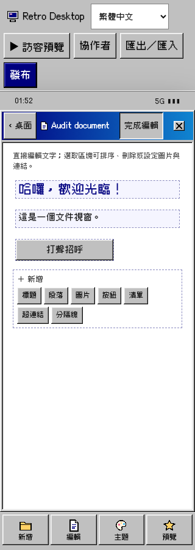](evidence/document-edit-320.png)手機可刪除內容，卻沒有可觸控的復原與持續儲存狀態 — 點圖開啟原尺寸

F02 · P1已觀察（觸控）

### IG「完成編輯」無聲丟棄尚未完成的欄位草稿

**重現：**觸控 context 320/390/430 → IG → 編輯 → Handle 清空 → 點顯示名稱使其 blur → 完成編輯 → 再編輯。原本空字串消失，Handle 變回 retro；沒有放棄/繼續提示，也沒有存檔。

**影響：**「完成」給出成功感，但使用者未完成內容其實被銷毀。這不是儲存回應競態；canonical 文件仍是舊值。

**替代：**把未完成欄位緩衝與 issue 註冊到 site/window/profile editor session。完成／關閉／返回前：有效草稿 commit；無效或未完成草稿提供繼續編輯與明確放棄。單純分類／角色／局部預覽切換保留緩衝。不要把無效值寫入 schema。

**可測驗收：**相同觸控重現不會無聲還原；繼續返回該欄位及游標，放棄才恢復已儲存值。有效 blur/Enter、IME、Undo/Redo、跨角色原始上傳目標各自測試。不得讓別的角色收到前一個草稿。

來源：[`apps/web/src/features/site/MobileScreen.tsx:137`](https://github.com/laiw54724-ui/retro/blob/8e2e54241ecca4c79cb5d6190e7b4b0beb804075/apps/web/src/features/site/MobileScreen.tsx#L137) · [`apps/web/src/features/modules/instagram/IgDraftInput.tsx:1`](https://github.com/laiw54724-ui/retro/blob/8e2e54241ecca4c79cb5d6190e7b4b0beb804075/apps/web/src/features/modules/instagram/IgDraftInput.tsx#L1) · [`apps/web/src/features/editor/editorSession.tsx:23`](https://github.com/laiw54724-ui/retro/blob/8e2e54241ecca4c79cb5d6190e7b4b0beb804075/apps/web/src/features/editor/editorSession.tsx#L23)

證據：touch-draft-320.json · touch-draft-390.json · touch-draft-430.json

**精選畫面證據**

[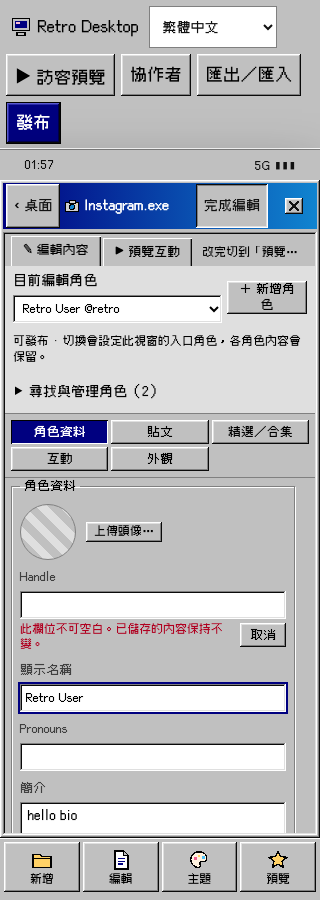](evidence/ig-invalid-before-finish-320.png)IG「完成編輯」無聲丟棄尚未完成的欄位草稿 — 點圖開啟原尺寸

F03 · P1已觀察

### 發布前檢查沒有 modal 焦點與鍵盤關閉契約

**重現：**1440/320/390/430 → 發布。初始 focus 留在外面；將焦點放最後「確認發布」按 Tab，焦點離開 dialog；Escape 不關閉。

**影響：**鍵盤／讀屏使用者可能離開目前決策層，甚至進入背景作者控制。宣告 aria-modal 不會自動提供 modal 行為。

**替代：**使用共用的 ModalDialog 或等效原生模式，將 initial focus 放可理解的檢查摘要或取消，循環 Tab、背景 inert、Escape 取消、焦點返回發起鈕。busy 時也需清楚可預期的退出規則。盤點同型的 transfer/conflict/assets/success dialog。

**可測驗收：**四寬度 Tab/Shift+Tab 不離開；Escape 只取消最上層且不發送 publish；背景 Undo/刪除不觸發；成功與失敗新狀態有宣告及 focus。保留 mock success/artifact-retry 回應隔離測試。

來源：[`apps/web/src/pages/EditorPage.tsx:780`](https://github.com/laiw54724-ui/retro/blob/8e2e54241ecca4c79cb5d6190e7b4b0beb804075/apps/web/src/pages/EditorPage.tsx#L780) · [`apps/web/src/components/ModalDialog.tsx:23`](https://github.com/laiw54724-ui/retro/blob/8e2e54241ecca4c79cb5d6190e7b4b0beb804075/apps/web/src/components/ModalDialog.tsx#L23) · [`apps/web/src/features/transfer/TransferDialog.tsx:68`](https://github.com/laiw54724-ui/retro/blob/8e2e54241ecca4c79cb5d6190e7b4b0beb804075/apps/web/src/features/transfer/TransferDialog.tsx#L68)

證據：shell-probe-1440.json · shell-probe-320.json

**精選畫面證據**

[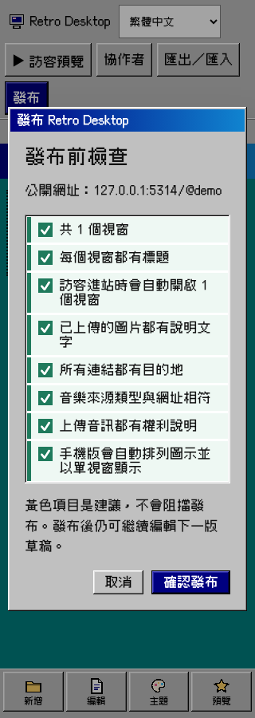](evidence/publish-320.png)發布前檢查沒有 modal 焦點與鍵盤關閉契約 — 點圖開啟原尺寸

F04 · P2已觀察

### 手機視窗設定 sheet 按 Escape 關掉後面的元件

**重現：**手機開文件並編輯 → 底部「編輯」→ 焦點放 sheet 關閉 → Shift+Tab 已離開 sheet；Escape 後 sheet 仍顯示，但原本文件 app 消失。三種寬度一致。

**影響：**返回層級錯誤；使用者仍在設定某個已被關閉的內容，失去上下文。

**替代：**sheet 作為最上層處理 Escape、focus、背景限制及返回焦點；關閉只收起 sheet，保留底下開啟元件及內容編輯狀態。

**可測驗收：**每個 add/edit/theme sheet 均測 Escape、關閉鈕、遮罩、Tab；只收最上層且 openId/inlineEdit/scroll 不變。重新開啟不跳回桌面。

來源：[`apps/web/src/features/site/MobileScreen.tsx:86`](https://github.com/laiw54724-ui/retro/blob/8e2e54241ecca4c79cb5d6190e7b4b0beb804075/apps/web/src/features/site/MobileScreen.tsx#L86) · [`apps/web/src/features/site/MobileScreen.tsx:194`](https://github.com/laiw54724-ui/retro/blob/8e2e54241ecca4c79cb5d6190e7b4b0beb804075/apps/web/src/features/site/MobileScreen.tsx#L194)

證據：shell-probe-320.json · shell-probe-390.json · shell-probe-430.json

**精選畫面證據**

[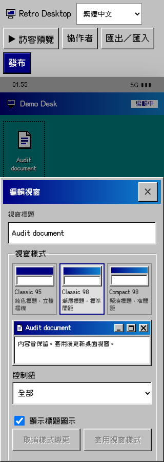](evidence/sheet-escape-320.png)手機視窗設定 sheet 按 Escape 關掉後面的元件 — 點圖開啟原尺寸

F05 · P2已觀察＋設計語意問題

### 「目前編輯角色」同時改變訪客入口

**重現：**IG 的目前編輯角色 select 由 retro 改 second。四寬度皆出現一次 autosave，window.content.profileRef 變成 second。下方小字確有說明，但主操作仍呈現選取編輯對象。

**影響：**只是查看／整理另一個角色，會改掉視窗首頁；後續發布可能帶出使用者沒打算更動的入口。

**替代：**將 editor currentProfileId 與 persisted entry profileRef 分開。上下文顯示「編輯角色 B」與「此視窗首頁 A」；只有「設為首頁角色」明確動作寫入。若本批只改版面，先正名既有 selector 為入口角色，行為拆分另做獨立 slice。

**可測驗收：**單純角色選取零 saves／零 Undo，該角色草稿／filter/scroll 保留；明確設定入口恰一個可 Undo 變更，reload 與 visitor 都開對角色。刪除/retarget 仍維持參照完整性。

來源：[`apps/web/src/features/modules/instagram/ProfileSwitcher.tsx:35`](https://github.com/laiw54724-ui/retro/blob/8e2e54241ecca4c79cb5d6190e7b4b0beb804075/apps/web/src/features/modules/instagram/ProfileSwitcher.tsx#L35) · [`apps/web/src/pages/EditorPage.tsx:197`](https://github.com/laiw54724-ui/retro/blob/8e2e54241ecca4c79cb5d6190e7b4b0beb804075/apps/web/src/pages/EditorPage.tsx#L197)

證據：ig-switch-1440.json · ig-switch-320.json · ig-switch-390.json · ig-switch-430.json

**精選畫面證據**

[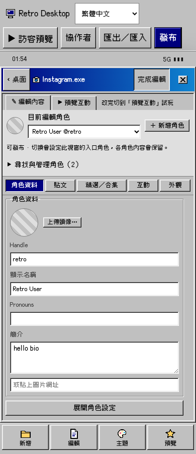](evidence/ig-profile-390.png)「目前編輯角色」同時改變訪客入口 — 點圖開啟原尺寸

F06 · P2已觀察

### IG 貼文任務被固定上下文、上傳與篩選推到下方

**重現：**320×900 → IG 編輯 → 貼文。不操作任何篩選，第一個貼文 row 約 y=826；底部工具列約 y=839，實質內容不在第一畫面。桌面預設420×700視窗也僅見第一篇標題/文字開頭。

**影響：**最常見的「改這篇文字／圖片」要先穿過上傳、說明、搜尋、狀態、置頂等管理控制；不是缺少教學。

**替代：**清單頁只留新增、搜尋、篩選入口與貼文 row；點一篇進 focused detail，首屏直接顯示當前貼文與主要欄位。次要 metadata/虛構互動漸進展開。桌面可用既有臨時 maximize/focus 模式擴大編輯，不改公開幾何。

**可測驗收：**320×900 首屏能看見一筆可辨識貼文及新增動作；390/430不更差。選取一篇後 title/caption/media 可達；返回清單復原篩選、選取、scroll；新貼文焦點有明確位置；filter無匹配有clear。

來源：[`apps/web/src/features/modules/instagram/IgEditorWorkspace.tsx:68`](https://github.com/laiw54724-ui/retro/blob/8e2e54241ecca4c79cb5d6190e7b4b0beb804075/apps/web/src/features/modules/instagram/IgEditorWorkspace.tsx#L68) · [`apps/web/src/features/modules/instagram/CanonicalPostEditor.tsx:130`](https://github.com/laiw54724-ui/retro/blob/8e2e54241ecca4c79cb5d6190e7b4b0beb804075/apps/web/src/features/modules/instagram/CanonicalPostEditor.tsx#L130) · [`apps/web/src/features/modules/instagram/ocEditor.module.css:17`](https://github.com/laiw54724-ui/retro/blob/8e2e54241ecca4c79cb5d6190e7b4b0beb804075/apps/web/src/features/modules/instagram/ocEditor.module.css#L17)

證據：ig-posts-320.json · ig-posts-1440.json

**精選畫面證據**

[](evidence/ig-posts-320.png)IG 貼文任務被固定上下文、上傳與篩選推到下方 — 點圖開啟原尺寸

F07 · P2已觀察＋來源確認

### 精選故事與貼文合集擠在同一條長表單

**重現：**精選／合集 tab 同時渲染 CanonicalHighlightEditor 與 CanonicalCollectionEditor；預設展開一個精選，手機畫面只見故事欄位，合集在更下面。

**影響：**兩種不同任務共享同一列表／捲動上下文，使用者不容易找出自己要的是多頁故事還是既有貼文分組。

**替代：**分類內加「精選故事／貼文合集」切換，分別用清單→單項編輯。只隱藏非目前區域或把草稿狀態提升；不能用卸載來換取畫面整潔。

**可測驗收：**兩種入口在三個手機寬度均可見；切換零存檔且保留未完成標題、filter、選取、scroll；故事頁順序與合集選取順序不變；#124 任務狀態在收起後仍可找到。

來源：[`apps/web/src/features/modules/instagram/IgEditorWorkspace.tsx:112`](https://github.com/laiw54724-ui/retro/blob/8e2e54241ecca4c79cb5d6190e7b4b0beb804075/apps/web/src/features/modules/instagram/IgEditorWorkspace.tsx#L112) · [`apps/web/src/features/modules/instagram/CanonicalHighlightEditor.tsx:1`](https://github.com/laiw54724-ui/retro/blob/8e2e54241ecca4c79cb5d6190e7b4b0beb804075/apps/web/src/features/modules/instagram/CanonicalHighlightEditor.tsx#L1) · [`apps/web/src/features/modules/instagram/CanonicalCollectionEditor.tsx:1`](https://github.com/laiw54724-ui/retro/blob/8e2e54241ecca4c79cb5d6190e7b4b0beb804075/apps/web/src/features/modules/instagram/CanonicalCollectionEditor.tsx#L1)

證據：ig-collections-320.json · ig-collections-430.json

**精選畫面證據**

[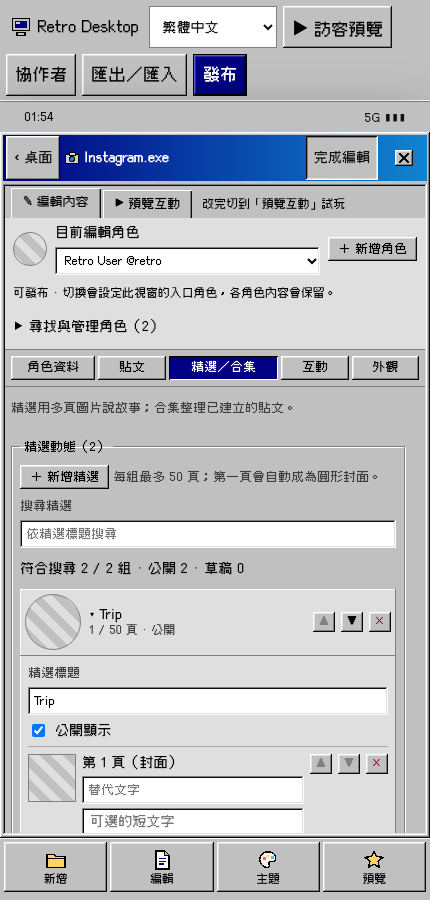](evidence/ig-collections-430.png)精選故事與貼文合集擠在同一條長表單 — 點圖開啟原尺寸

F08 · P2已量測

### IG 手機的排序／刪除控制太小且彼此緊鄰

**重現：**精選故事 row 的刪除按鈕在320/390/430皆22×20 CSS px，與上下排序相鄰；分類 tabs 為24px高。圖片與貼文也沿用 mini-btn。

**影響：**小螢幕上誤觸破壞性動作的代價高，尤其目前還缺可觸控 Undo。

**替代：**手機改44px以上命中區，排序保留明確按鈕；低頻刪除移入已命名的項目操作選單，保留鍵盤捷徑與Undo。外觀可仍是復古小圖示，命中區不可跟著縮。

**可測驗收：**320/390/430量測可操作區至少44×44且不重疊；順序/刪除 accessible name 含項目名稱或序號；鍵盤可達；觸控操作成功且不需精準瞄準。這是產品目標，不宣稱完整WCAG稽核。

來源：[`apps/web/src/features/modules/instagram/CanonicalPostEditor.tsx:181`](https://github.com/laiw54724-ui/retro/blob/8e2e54241ecca4c79cb5d6190e7b4b0beb804075/apps/web/src/features/modules/instagram/CanonicalPostEditor.tsx#L181) · [`apps/web/src/features/modules/instagram/CanonicalHighlightEditor.tsx:1`](https://github.com/laiw54724-ui/retro/blob/8e2e54241ecca4c79cb5d6190e7b4b0beb804075/apps/web/src/features/modules/instagram/CanonicalHighlightEditor.tsx#L1) · [`apps/web/src/features/modules/instagram/ocEditor.module.css:17`](https://github.com/laiw54724-ui/retro/blob/8e2e54241ecca4c79cb5d6190e7b4b0beb804075/apps/web/src/features/modules/instagram/ocEditor.module.css#L17)

證據：ig-collections-320.json · ig-collections-390.json · ig-collections-430.json

F09 · P2已觀察

### 掃雷數值欄位清空就改成最小值並儲存

**重現：**1440或320 → 掃雷編輯 → 清空「列」。欄位立即顯示5；等待後 savedRows=5、saves=1。使用者尚未輸入新數字。

**影響：**正常的先清空再打字被當成已完成設定，還會重置試玩棋盤。與現有 geometry/IG count 草稿行為不一致。

**替代：**沿用既有數值 draft 模式，允許暫時空白；blur/Enter驗證範圍再 commit，Escape恢復已套用值。難度預設仍可立即套用。Moodboard字級直接clamp路徑另做相同驗證。

**可測驗收：**清空零存檔、棋盤不重置；輸入有效12後commit僅一個Undo；無效/小數不把舊值污染；手機numeric鍵盤與IME/Enter/Escape有獨立案例。

來源：[`apps/web/src/features/modules/minesweeper/index.tsx:39`](https://github.com/laiw54724-ui/retro/blob/8e2e54241ecca4c79cb5d6190e7b4b0beb804075/apps/web/src/features/modules/minesweeper/index.tsx#L39) · [`apps/web/src/features/modules/minesweeper/index.tsx:57`](https://github.com/laiw54724-ui/retro/blob/8e2e54241ecca4c79cb5d6190e7b4b0beb804075/apps/web/src/features/modules/minesweeper/index.tsx#L57) · [`apps/web/src/features/modules/moodboard/index.tsx:183`](https://github.com/laiw54724-ui/retro/blob/8e2e54241ecca4c79cb5d6190e7b4b0beb804075/apps/web/src/features/modules/moodboard/index.tsx#L183)

證據：mines-number-1440.json · mines-number-320.json

**精選畫面證據**

[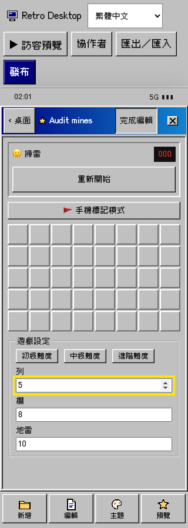](evidence/mines-empty-number-320.png)掃雷數值欄位清空就改成最小值並儲存 — 點圖開啟原尺寸

F10 · P2已觀察

### 建立桌面：網址可用性請求失敗後永久顯示「正在檢查」

**重現：**本機將 /api/usernames/audit-demo/availability 回應500；有效網址填入後，請求已完成但畫面仍「正在檢查...」、下一步disabled，只有上一步/下一步兩個鈕。1440/320一致。

**影響：**使用者不知道是網路失敗或還在等，沒有保持原輸入的明確重試。

**替代：**把 pending、available、taken、failed 分成獨立狀態；failed 顯示「暫時無法檢查」與重試，保留名稱/網址。回應序號仍綁最新輸入，避免舊結果覆蓋。

**可測驗收：**500/offline明確轉failed，retry同值成功能下一步；晚到結果不更新新網址；taken保留可編輯建議；三個手機寬度無溢出。

來源：[`apps/web/src/pages/OnboardingPage.tsx:22`](https://github.com/laiw54724-ui/retro/blob/8e2e54241ecca4c79cb5d6190e7b4b0beb804075/apps/web/src/pages/OnboardingPage.tsx#L22)

證據：onboarding-failure-1440.json · onboarding-failure-320.json

**精選畫面證據**

[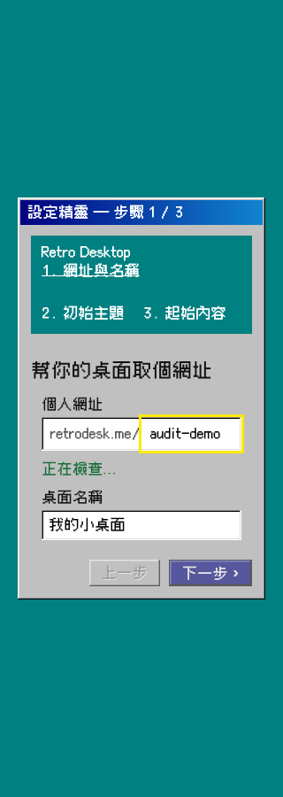](evidence/onboarding-failure-320.png)建立桌面：網址可用性請求失敗後永久顯示「正在檢查」 — 點圖開啟原尺寸

F11 · P2已觀察＋設計判斷

### 手機兩個「編輯」入口其實做不同事情

**重現：**打開元件，標題列「編輯此視窗」進內容編輯；底部「編輯」開視窗設定 sheet，內容編輯提示卻藏在該長sheet底部。

**影響：**使用者按習慣的底部編輯會找不到文章/圖片內容，轉而面對chrome/色彩/圖示設定；上下兩層缺乏清楚範圍。

**替代：**底部正名「視窗設定」，標題列正名「編輯內容／完成」。若沒有選取，顯示選取提示；在設定頂端提供返回目前元件內容，不要在長表單底部才告知關閉與再找入口。

**可測驗收：**對每個registry元件同樣語意；兩個入口accessible name明確，切換不改 selectedId/openId，不丟未完成草稿；與F04的正確關層一起驗收。

來源：[`apps/web/src/features/site/MobileScreen.tsx:135`](https://github.com/laiw54724-ui/retro/blob/8e2e54241ecca4c79cb5d6190e7b4b0beb804075/apps/web/src/features/site/MobileScreen.tsx#L135) · [`apps/web/src/features/site/MobileScreen.tsx:183`](https://github.com/laiw54724-ui/retro/blob/8e2e54241ecca4c79cb5d6190e7b4b0beb804075/apps/web/src/features/site/MobileScreen.tsx#L183) · [`apps/web/src/features/site/MobileScreen.tsx:250`](https://github.com/laiw54724-ui/retro/blob/8e2e54241ecca4c79cb5d6190e7b4b0beb804075/apps/web/src/features/site/MobileScreen.tsx#L250)

證據：sheet-320.json · document-edit-320.json

F12 · P3已觀察，非發布阻擋

### 預設桌面小視窗與大預覽壓縮基本作者欄位

**重現：**以makeWindow預設開About，1440×900時視窗約340×360，頭像預覽160px高，第一個姓名欄位落在捲動後；角色彈窗也先用大預覽再放資料。#122 Paint手機把長鍵盤說明置於畫布上方。

**影響：**第一次操作要先捲動才能改核心內容；有足夠桌面空間卻沿用訪客尺寸編輯。

**替代：**讓頭像與主要文字並列或縮成緊湊列；提供「放大編輯」重用臨時maximize，保留公開尺寸。Paint手機把完整快捷鍵列表收進可開啟說明，當前工具/顏色/復原維持可見。

**可測驗收：**姓名/主要訊息在預設作者首屏可見；放大與還原不存layout；Paint320px canvas有合理可見面積且save/export仍可達。先修P1/P2，不為此加新模式或攔住#122。

來源：[`apps/web/src/features/modules/about/index.tsx:76`](https://github.com/laiw54724-ui/retro/blob/8e2e54241ecca4c79cb5d6190e7b4b0beb804075/apps/web/src/features/modules/about/index.tsx#L76) · [`apps/web/src/features/modules/character-dialog/index.tsx:1`](https://github.com/laiw54724-ui/retro/blob/8e2e54241ecca4c79cb5d6190e7b4b0beb804075/apps/web/src/features/modules/character-dialog/index.tsx#L1) · [`packages/shared/src/site.ts:534`](https://github.com/laiw54724-ui/retro/blob/8e2e54241ecca4c79cb5d6190e7b4b0beb804075/packages/shared/src/site.ts#L534)

證據：about-edit-1440.json · character-dialog-edit-1440.json

**精選畫面證據**

[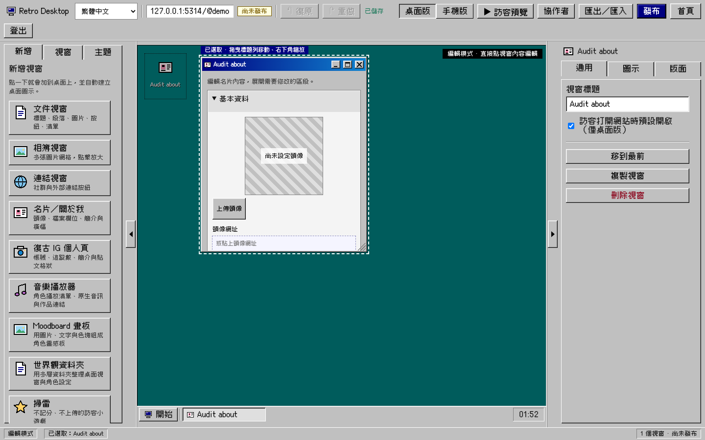](evidence/about-edit-1440.png)預設桌面小視窗與大預覽壓縮基本作者欄位 — 點圖開啟原尺寸

<a id="coverage"></a>

## 全元件覆蓋矩陣

「4 寬度」代表1440×900、320×900、390×900、430×900的專用capture流程。既有cases另有1280、375、不同高度與safe-area模擬。V＝實際渲染截圖／檢查；I＝列明的互動已執行；S＝來源檢閱；G＝未啟用／未跑。每列列出實際覆蓋，不把V當作所有I都通過。

| 元件（12/12） | 從程式碼列出的任務 | 實際覆蓋與限制 | 設計判斷／保留 | 支援證據 |
| --- | --- | --- | --- | --- |
| **文件**<br>`document`<br>[`apps/web/src/features/modules/document/index.tsx`](https://github.com/laiw54724-ui/retro/blob/8e2e54241ecca4c79cb5d6190e7b4b0beb804075/apps/web/src/features/modules/document/index.tsx) | 七種區塊：標題、段落、圖片、按鈕、連結、清單、分隔線；選取工具、格式、排序、刪除、圖片來源／caption／alt、訪客連結。 | 4 寬度編輯與預覽；320/390px 文字與圖片欄位正常點選、儲存／reload；刪除後焦點；圖片上傳歸屬及晚到回應。 | 保留直接編輯文字、選取才出工具的方式。先補手機 Undo 與本地未完成輸入的共同離開處理。 | inline-editor-preservation, media-tasks<br>[320px](evidence/document-edit-320.png) · 桌面（原始截圖未納入精簡包） |
| **相簿**<br>`gallery`<br>[`apps/web/src/features/modules/gallery/index.tsx`](https://github.com/laiw54724-ui/retro/blob/8e2e54241ecca4c79cb5d6190e7b4b0beb804075/apps/web/src/features/modules/gallery/index.tsx) | 批次新增、來源網址、欄數、縮圖清單、單圖屬性、更換、caption/alt、裝飾性圖片、排序／刪除、Lightbox。 | 4 寬度空狀態／編輯／預覽；批次部分失敗／重試／順序、選取保留、刪除焦點、protected-image 失敗；lightbox Tab/Escape/左右鍵/返回焦點。 | 保留「縮圖清單＋一張圖片屬性」；可作為 IG 媒體編輯的既有參考。手機 Undo 為共同缺口。 | media-tasks, inline-editor-preservation, component-operations<br>320px（原始截圖未納入精簡包） · 桌面（原始截圖未納入精簡包） |
| **連結**<br>`links`<br>[`apps/web/src/features/modules/links/index.tsx`](https://github.com/laiw54724-ui/retro/blob/8e2e54241ecca4c79cb5d6190e7b4b0beb804075/apps/web/src/features/modules/links/index.tsx) | 可直接改標籤；設定區的網址／視窗目標、摘要、色彩、IconPicker、排序、刪除；訪客缺失目標。 | 4 寬度編輯／預覽；長文字、無效及空目標、切換目的地、Undo/reload、公眾視窗開啟。 | 保留逐條設定與可讀目標摘要；最新 main 已含 #120 訪客 Back/focus，保留，不另寫一套。 | about-links-ux, public-sharing<br>320px（原始截圖未納入精簡包） · 桌面（原始截圖未納入精簡包） |
| **名片／關於我**<br>`about`<br>[`apps/web/src/features/modules/about/index.tsx`](https://github.com/laiw54724-ui/retro/blob/8e2e54241ecca4c79cb5d6190e7b4b0beb804075/apps/web/src/features/modules/about/index.tsx) | 頭像／裁切／網址、暱稱、標語、簡介、引言、橫幅、自訂欄位、社群連結、訪客文字。 | 4 寬度編輯／預覽；320/390px 輸入焦點、刪除及 Undo、來源晚到、protected-media、reload、公眾顯示。 | 基本／自訂欄位／社群分組可保留。桌面預設小視窗的大頭像把姓名推到捲動區下方，宜縮成頭像列或提供明確放大編輯。 | about-links-ux, inline-editor-preservation, media-tasks<br>320px（原始截圖未納入精簡包） · [桌面](evidence/about-edit-1440.png) |
| **IG／OC**<br>`instagram`<br>[`apps/web/src/features/modules/instagram/index.tsx`](https://github.com/laiw54724-ui/retro/blob/8e2e54241ecca4c79cb5d6190e7b4b0beb804075/apps/web/src/features/modules/instagram/index.tsx) | 角色切換與管理、身分／進階資料、貼文與輪播、精選故事、合集、虛構關係／讚／留言、外觀；訪客目錄、貼文、收藏、故事、人物與 deep link。 | 4 寬度五分類實際操作；三個觸控 context 的未完成草稿；角色切換寫入、Arrow tabs；既有 OC／社交／篩選／合集／捲動／隱私／公開導覽互動。 | 優先採本報告 IG 任務流程；#121/#124 解決媒體復原，不能取代資訊架構修正。 | oc-profiles, ig-validation, preview-sources, public-sharing<br>[IG畫面](evidence/ig-profile-390.png) |
| **音樂**<br>`music`<br>[`apps/web/src/features/modules/music/index.tsx`](https://github.com/laiw54724-ui/retro/blob/8e2e54241ecca4c79cb5d6190e7b4b0beb804075/apps/web/src/features/modules/music/index.tsx) | 播放清單、選取單曲、封面、統一來源欄位、檔案上傳、來源判定、原站／官方 player／原生音訊影片、角色、權利、歌詞、逐檔狀態與重試。 | 4 寬度編輯／預覽；來源及封面草稿、鍵盤選取、排序/reload、逐檔失敗／重試／取消晚到、停止舊預覽；手機長歌詞及 safe area。 | 已實現「貼網址／上傳，由系統辨識」；保留，不再要求先選來源類型。複雜來源說明用當下判定結果呈現。 | music-authoring, mobile-shell<br>320px（原始截圖未納入精簡包） · 桌面（原始截圖未納入精簡包） |
| **Moodboard**<br>`moodboard`<br>[`apps/web/src/features/modules/moodboard/index.tsx`](https://github.com/laiw54724-ui/retro/blob/8e2e54241ecca4c79cb5d6190e7b4b0beb804075/apps/web/src/features/modules/moodboard/index.tsx) | 文字、色塊、圖片、背景、元素清單、拖曳／鍵盤選取、位置尺寸、層序、鎖定、複製／刪除、PNG 匯出。 | 4 寬度編輯／預覽；元素遮擋選取、精確 geometry、指標移動、鍵盤、Undo/reload、PNG 成功及跨來源失敗。 | 保留畫布＋元素清單與數值替代操作。字級仍直接 clamp 的路徑列為來源待驗證；不要新增拖曳專用操作。 | moodboard, moodboard-properties, component-operations<br>320px（原始截圖未納入精簡包） · 桌面（原始截圖未納入精簡包） |
| **世界觀資料夾**<br>`explorer`<br>[`apps/web/src/features/modules/explorer/index.tsx`](https://github.com/laiw54724-ui/retro/blob/8e2e54241ecca4c79cb5d6190e7b4b0beb804075/apps/web/src/features/modules/explorer/index.tsx) | 資料夾／捷徑、階層 breadcrumb、搜尋、建立目標、Rename/F2、Move／拖曳、複製、可見狀態、刪除影響確認。 | 4 寬度空態／編輯／預覽；單擊選取、雙擊／Enter、F2/Escape/Delete、拖動及 Move 替代；刪除參照／Undo/reload；手機 ⋯ 及 visitor 導覽。 | 保留資料夾與捷徑語意。健康捷徑改目標由 #123 提供；手機 preview 複製 focus key 的返回焦點問題已由 #126 修正並併入最新 main，不重複列待辦。 | explorer, public-sharing<br>320px（原始截圖未納入精簡包） · 桌面（原始截圖未納入精簡包） |
| **掃雷**<br>`minesweeper`<br>[`apps/web/src/features/modules/minesweeper/index.tsx`](https://github.com/laiw54724-ui/retro/blob/8e2e54241ecca4c79cb5d6190e7b4b0beb804075/apps/web/src/features/modules/minesweeper/index.tsx) | 遊戲棋盤、狀態／重新開始、旗標模式、難度預設、列／欄／地雷數、鍵盤移動與窄螢幕橫向棋盤。 | 4 寬度編輯／預覽；5/8/12 欄到最右格的鍵盤 reachability；1440/320px 清空數值實際變成 5 且儲存。 | 保持簡單訪客遊戲；修正數值草稿，讓設定與試玩有清楚分組。只需可收合的一行旗標／鍵盤說明。 | component-operations + numeric drafts probe<br>320px（原始截圖未納入精簡包） · 桌面（原始截圖未納入精簡包） |
| **角色彈窗**<br>`character-dialog`<br>[`apps/web/src/features/modules/character-dialog/index.tsx`](https://github.com/laiw54724-ui/retro/blob/8e2e54241ecca4c79cb5d6190e7b4b0beb804075/apps/web/src/features/modules/character-dialog/index.tsx) | 角色圖／移除、名稱、訊息、連結、auto-show 設定；訪客關閉與重開、同名視窗焦點。 | 4 寬度編輯／預覽；圖片移除 Undo/reload；auto-show 關閉／重開、競爭開窗、精確 opener 返回。 | 既有焦點修正有效，保留。編輯模式中的大預覽可收起以讓資料先出現；不要為此增加強制導覽。 | character-dialog-45<br>320px（原始截圖未納入精簡包） · 桌面（原始截圖未納入精簡包） |
| **留言簿**<br>`guestbook`<br>[`apps/web/src/features/modules/guestbook/index.tsx`](https://github.com/laiw54724-ui/retro/blob/8e2e54241ecca4c79cb5d6190e7b4b0beb804075/apps/web/src/features/modules/guestbook/index.tsx) | 允許提交、說明、全部／待審／已公開／檢舉／已拒絕、審核動作；訪客提交／重試／report；預覽沙盒。 | 4 寬度編輯／預覽；公開純文字、失敗保留提交、手機；審核佇列重試與單列鎖定／晚到隔離；preview sandbox 不寫入。 | 預設待審與 preview 提示清楚，保留。服務端審核不是編輯 Undo，錯誤須留在當列；不新增教學流程。 | guestbook, guestbook-moderation, guestbook-preview<br>320px（原始截圖未納入精簡包） · 桌面（原始截圖未納入精簡包） |
| **單張圖片**<br>`image`<br>[`apps/web/src/features/modules/image/index.tsx`](https://github.com/laiw54724-ui/retro/blob/8e2e54241ecca4c79cb5d6190e7b4b0beb804075/apps/web/src/features/modules/image/index.tsx) | reader 與呈現契約：來源、alt/caption、contain/cover/original、裁切、背景、pixelated、無框／簡框、裝飾性模式；writer 已在程式中但受 gate。 | 四寬度 editor reader／visitor synthetic image 截圖；既有 reader compatibility 7 案例（含零寫入與 426）；writer 僅來源檢閱，未改開關。 | reader 可用不等於作者功能已發布。先通過原本 reader/API/private-media/release gate；本報告不給完成日期，不用引導顯示不存在的按鈕。 | image-reader-compatibility + image reader probe<br>image reader（原始截圖未納入精簡包） |

### Shell、路由、媒體與共同對話框

| 表面 | 實作來源 | 已做 | 仍未驗證／邊界 |
| --- | --- | --- | --- |
| 首頁／登入 | LandingPage, AuthPage | 首頁、範例入口、登入錯誤與 Google 按鈕。首頁四寬度截圖；landing axe 無 critical 案例通過。 | Google 真正 OAuth／帳號服務未跑；匿名登入畫面本輪以來源檢閱為主。 |
| 桌面清單 | DesktopHub | 擁有者／editor／viewer 卡片、狀態、開啟、新增、空態／失敗重試；既有 4 案例與四寬度實際畫面。 | 權限與後端資料皆 mock。 |
| 建立桌面 | OnboardingPage | 三步前進／返回保留輸入、主題與範本，四寬度；500 availability 失敗探針。 | 建立真正帳號／站台未送出；正常建立 API 不是本次驗收。 |
| 協作／邀請／唯讀 | InvitePage, CollaborativeSitePage, CollaborationDialog, DraftViewer | 9 既有案例：邀請接受／錯誤、320px、viewer 唯讀、editor 權限、失權離開、管理者新增撤銷／角色變更。 | 全部使用假的本機身份與 API；未寄出真邀請。 |
| 桌面編輯 shell | EditorPage, DesktopCanvas, LeftPanel, RightPanel | 選取、焦點背景、模式、側欄收合、圖示／視窗 layout、8px snapping、max/min/close/restore、不改文檔 view state。 | 四寬度共用 capture；桌面 1440 專案 baseline。多視窗極端密度未逐一驗收。 |
| 手機編輯 shell | MobileScreen（實際使用） | 首頁 → 開元件 → 編輯此視窗／完成、底部新增／編輯／主題／預覽、safe area、長內容捲動；四寬度與 touch probe。 | MobileEditor.tsx 是 dormant 舊實作，不當成第二套現行 UI。虛擬鍵盤／真機安全區未跑。 |
| 視窗樣式／幾何／圖示 | WindowChromeEditor, WindowAppearanceEditor, IconPicker, CropEditor | 既有主題、layout、圖示 lazy library/search/categories/preview/apply/cancel/focus/upload/reload；幾何精確輸入被既有 suites 覆蓋。 | appearanceP2 的另一組 gated writer 未啟用；全部 theme permutations 未視覺逐格檢查。 |
| 媒體共同流程 | FilePick, ImageUrlField, SafeImg, editorMedia, uploadTasks | 可重選同檔、網址草稿、保留 caption/alt、逐檔 retry、原始目標、刪除／Undo／switch 後晚到丟棄、protected image 錯誤。 | 沒有 live upload/HTTP abort/provider/native acceptance。#121/#124 以 PR 檢閱為主。 |
| 儲存／Undo／離開 | EditorPage, store, editorSession | 27 save-session 案例含衝突、500/403/409/426、路由離開、回應隔離、Retry、theme preview；手機狀態／Undo 缺口實測。 | 元件本地草稿不等同 canonical dirty；IG Finish loss 已另外重現。 |
| 發布／衝突／資產清單 | EditorPage, DocumentUpgradeRecovery | mock publish success、artifact failure/retry、離開後回應、remote reload、存取失權；發布前 dialog 四寬度 focus probe。 | 真正 publish 未執行；資產清單與每一種阻擋 check 只來源檢閱，不宣稱逐項 UI 驗收。 |
| 匯入／匯出 | TransferDialog | JSON export、missing-media preview、新複本 import、ZIP 拒絕與320px，2既有案例。 | dialog 焦點缺口與共享模式相似，但本次只對 Publish／phone sheet 做獨立焦點探針。 |
| 訪客預覽 | VisitorPreview, DesktopPreviewViewport, MobileScreen | 可發布／目前草稿分離、開新頁與share狀態、mobile/desktop viewport、zoom session、nested Escape、Back、零autosave/Undo。 | IG「預覽互動」是另一個局部模式；返回正在編輯貼文的連續性列為設計建議，尚未新寫 acceptance。 |
| 訪客桌面／手機 | VisitorDesktop, DesktopTaskbar, MobileScreen | 圖示、Start、最小化／重開、下層返回、local clock、手機單視窗、語言menu、deep links、share fallback及私有資料排除。 | #120 Links return 不在原始基準，已在最後核對的 main；非 Chromium／所有主題組合未跑。 |
| 共同 dialog／picker | ModalDialog, LinkTargetPicker, IntegrityDialog, IconPicker, Lightbox | picker Cancel/Escape、焦點、刪除影響、lightbox 輪播；現有正確基礎可重用。 | 不能因為有 ModalDialog 就推定所有 legacy section role=dialog 都符合；已發現例外。 |
| Paint 工具（版本見下） | PR #122 PaintEditorEntry/Dialog/Workspace | 7342aca 專用 worktree/5315：6 現有案例＋430px draw/export/save；桌面、320、390、430 screenshot。 | 原始基準未含；最新 main 已含同一 source head。匯入/進階筆刷 native 高頻指標本輪未重跑；沒有 Pencil/Safari/live asset 驗收。 |
| 尚未實作項 | registry COMING_SOON；Dialog/UiActions/animation plans | 日記、角色檔案、視覺小說列在 coming-soon；通用 Dialog action／sequence 等只屬計畫。 | 不將計畫、debug host、disabled writer 算作已完成的使用者元件。 |

**沒有重做的已改善操作**

- Document 直接編輯文字，選取後才出區塊工具；Gallery 使用縮圖與一張圖屬性，刪除後可回焦；About 把欄位與社群分組。
- Music 已有一個貼網址／上傳入口、自動來源判斷、外部來源選擇與逐項回復；不再另設必選來源精靈。
- Explorer 已有Move dialog作為拖曳替代，F2／Escape和刪除影響說明；不能為追求「直接操作」刪除這些無障礙路徑。
- Preview 已區分發布後投影與目前草稿，提供正確分享邊界、零寫入與層級返回；應保留。
- 伺服器儲存session、theme預覽Apply/Cancel、private media、跨選取晚到保護已有大量既有測試；局部UI重構必須沿用。

<a id="help"></a>

## 幫助與聚焦教學：只教剩餘的概念

先完成F01–F11的操作修正，再評估是否需要額外引導。預設不自動彈出，不把流程不清楚轉嫁給教學，也不新增遙測。

| 位置 | 短版情境幫助 | 可選聚焦教學 | 目標／fallback |
| --- | --- | --- | --- |
| IG 精選／合集 | 「精選：多頁故事。合集：把已建立貼文整理在一起。」 | 若使用者主動點「如何整理作品」，最多3步：選任務→加入頁/貼文→預覽。可略過／重播。 | 只在當前角色/權限/元件存在時錨定；手機改為當頁說明卡，先關閉說明再聚焦實際入口。 |
| 整站預覽／發布 | 「草稿僅自己看；發布後預覽會排除未公開內容；儲存不等於發布。」 | 手動「發布前看什麼」可示範來源切換與發布檢查；不自動打開發布或幫使用者確認。 | 只錨定真實可見按鈕；viewer無發布權就顯示唯讀說明，不提供失效箭頭。 |
| 圖片caption/alt | Caption顯示給訪客；替代文字描述圖像；裝飾性圖片可不被讀屏朗讀。 | 通常不需要tour。原位一行help或可展開例子足夠。 | 保留可見label與aria-describedby；不靠placeholder／hover。image writer gated時不要出現「點新增圖片」。 |
| Music來源 | 依當前來源解釋：官方player需使用者點載入；檔案原生播放；其他網址開原站。 | 通常不需要tour。錯誤直接在來源旁給retry或開原站。 | 不自動載入provider作教學；mobile按鈕同樣可達。 |
| Explorer | 「捷徑是參照，刪除捷徑不會刪原內容。」 | 首次主動建立捷徑時可選「看例子」：選目標→命名→開啟。 | 找不到目標時顯示原因與返回搜尋，不能跳過失效target繼續tour。 |
| Paint／Moodboard／掃雷 | 目前工具／選取物件／旗標模式先可見，完整快捷鍵可展開。 | 主動選「鍵盤操作說明」才教一個任務；Paint先畫一筆→復原→匯出，勿自動提交資產。 | 未開放的Paint或image工具不建target；focus回原先Help鈕，若已不存在回sectionheading。 |

**教學驗收：**入口由使用者主動選擇；Skip/Close永遠可見；每步可返回及重播；下一步前檢查target連接、可見、未disabled且有權限。target不存在時解釋並提供安全返回，不強制開啟feature。不要劫持輸入或跨層搶focus；手機避免氣泡蓋住鍵盤與主要欄位。減少動態時不做游標飛移。沒有使用者資料寫入、發布、Undo紀錄或額外telemetry。

<a id="batches"></a>

## 問題 → 實作批次與檔案責任

此表是交接建議，不是本輪實作。協調者已指派IG結構與導覽兩條工作線；其餘標為未指派。共用檔案需先協調hunk，不能同時重寫MobileScreen／EditorPage。

| 批次／問題 | 狀態與主責檔案 | 界線與最低驗收 |
| --- | --- | --- |
| B1 手機復原與狀態 · F01 | 尚未指派。EditorPage.tsx:620–623渲染既有store.undo/redo/saveText；styles/w98.css:643以mobile-hide藏掉。store.ts:193/213是既有歷史契約，通常只需重用。 | 優先在EditorPage的手機常駐列呈現，與B3發布modal分開hunk；若一定要動MobileScreen先協調。320/390/430誤刪→Undo→Redo、saving/saved/error/retry、無背景命令穿透、固定列不蓋欄位。不要新增第二套history或改global mobile-hide讓所有控制塞回來。 |
| B2 IG任務結構／草稿 · F02/F05–F08 | 協調者已交接IG implementer。IgEditorWorkspace、ProfileSwitcher、CanonicalPostEditor、CanonicalHighlightEditor、IgDraftInput；必要時editorLocalWork與MobileScreen完成入口需協調。 | 先清單→單項、精選/合集分流、觸控尺寸；保留未完成buffer是前提。入口角色拆分獨立提交驗收。沿用已合併media queue，不重寫上傳transport。 |
| B3 對話框與返回層 · F03/F04；F11文案相鄰 | 協調者已交接navigation worker，先以#127 main為基準。MobileScreen的sheet與Escape；EditorPage的publish preflight；ModalDialog僅需要時擴充。 | 已合併#126 active-preview修正不能當本批完成。Tab/ShiftTab/初始focus/returnfocus/Escape只關top layer；背後編輯與未完成內容不消失；不觸發publish或Undo。F11底部編輯→視窗設定可一起做明確文案。 |
| B4 數值與建立失敗 · F09/F10 | 尚未指派。modules/minesweeper/index.tsx；OnboardingPage.tsx。Moodboard字級只有來源疑點，先補probe再決定。 | 清空可保留、blur/Enter驗證、Escape還原；availability區分pending/error/taken/free，Retry保留輸入並防舊回應覆寫。 |
| B5 次要可見性與說明 · F12＋情境help | 未指派，P1/P2後再做。about、character-dialog、PaintWorkspace；使用者主動的局部說明。 | 只修首屏主要任務可達；放大不寫公開geometry。沒有強制tour、自動攔截、新telemetry或不存在的gated target。 |
| 既有整合／Image readiness | 保留#127已併入的#120–126；#128仍候選。ImageWriter gate與release決策在既有責任線。 | 不把#124仍open誤當未整合，不重做健康捷徑Change target／媒體retry。Image沒有由本審核啟用，native/live403限制仍有效。 |

<a id="prs"></a>

## 現有 PR 與版本判讀

原始完整審核為8e2e542；最後補驗為f11ad8d。下列來源#120–126皆已進入最新main的Git ancestry；個別PR是否仍open不能用來判斷runtime是否已整合。詳細初始PR metadata留於 本機快照。

| PR／head | 已處理範圍 | 本輪審核方式與剩餘邊界 |
| --- | --- | --- |
| [#120](https://github.com/laiw54724-ui/retro/pull/120) · 8c1756a2 | Links→Explorer→post的Back/focus，穩定ID、失效目標、visitor零寫入。 | 讀PR與diff。沒有把缺陷重提為新設計；本輪main測試沒有套用此PR。 |
| [#121](https://github.com/laiw54724-ui/retro/pull/121) · d7e4ff6 | 頭像原始target與媒體queue、Retry/Cancel/remove、可見來源label、精選圖片原位更換。 | 讀PR/source/diff；結構流程與Finish草稿保留不在此修正內。 |
| [#122](https://github.com/laiw54724-ui/retro/pull/122) · 7342aca | Paint正式lazy入口、localPNG、顯式儲存新private asset＋Gallery、dirty/late guards、nested commands。 | 獨立checkout實跑7個distinct editor/save/export案例。最新main已含同一來源；原生手寫筆/實際storage未驗收。 |
| [#123](https://github.com/laiw54724-ui/retro/pull/123) · a018ba9 | 健康捷徑Change target、預選／摘要、Cancel/Escape焦點、不改label/icon/order、同target no-op。 | 讀metadata及source。早期PR自述preview duplicate focus key剩餘問題，已由#126/#127修正；本輪讀新diff，未重跑其完整integration。 |
| [#124](https://github.com/laiw54724-ui/retro/pull/124) · 7670b6b | canonical貼文／精選逐檔queue、取消／重試、即時草稿、部分成功保留、容量與順序。 | 依賴#121。讀PR與source；未套用到main browser suite。取消被計入failed與舊top-level banner殘留屬已記錄限制，非本輪新觀察。 |
| [#125](https://github.com/laiw54724-ui/retro/pull/125) · 2335e27 | #120/#121/#122第一個整合候選。 | 已由#127 superset包含；不應再獨立重複merge。 |
| [#126](https://github.com/laiw54724-ui/retro/pull/126) · 1dfb73b | 預覽返回focus只找active surface，非作用中editor不消耗Escape。 | 已進main。讀source差異；這個修正不同於F03發布modal和F04作者sheet，後兩項在新main仍可重現。 |
| [#127](https://github.com/laiw54724-ui/retro/pull/127) · 6c21c9e → f11ad8d | superset整合#120–126，18:05:34 UTC已合併。 | API state closed/merged與git ancestry雙重核對；本輪15個針對性觀察補驗，不是再次執行combined release gate。#124 PR仍open，但7670b6b已是main ancestor。 |
| [#128](https://github.com/laiw54724-ui/retro/pull/128) · 976c217 | Image readiness證據與作者控制文字背景對比修正；沒有啟用writer。 | 仍open/draft。讀metadata及唯一runtime CSS diff；對比1.641:1與跨engine通過是PR作者證據，不冒稱本輪獨立驗證。現有DEV＋opt-in gate仍阻止staging作者建立Image，需release owner處理既有流程。 |
| [#96](https://github.com/laiw54724-ui/retro/pull/96) | 資料庫寫入邊界提案，非本次UX實作。 | 沒有套用SQL或改設定。 |

最後核對已包含#128；#127已有整合工作的整合證據，本輪不把來源PR自述測試計入自己的數量。除15個針對性流程外，原始全元件／303案例資料仍明確屬於8e2e542，不能當f11ad8d的整體綠燈。

<a id="evidence"></a>

## 可重跑證據、執行帳與限制

測試環境：macOS / Node 22.21.0 / pnpm10.18.2 / Playwright1.64.1 Chromium1248，繁體中文。以frozen lockfile安裝；沒有使用production credentials。自己的fixture攔截所有非loopback請求；既有suite使用其mock auth/API/assets。既有suite可能有字型/靜態資源請求，但沒有真實外部mutation。

| 執行組 | 實際結果 | 證據／說明 |
| --- | --- | --- |
| Main既有互動suite A | 165案例：162 pass、3 fail、0 skip。 | primary log。兩個OC custom-field舊測試缺blur；一個audio teardown因本次兩個runner共用outputDir被清理而失敗。最後stdout JSON被工具截斷，保留可用list/summary，不偽稱完整JSON。 |
| Main既有互動suite B | 121/121 pass、0 skip。 | secondary log。含save-session、collaboration、image reader、IG validation、inline-editor、icon-picker、mobile-shell與transfer。 |
| Main route/guestbook補充 | 17/17 pass、0 skip。 | route log。含desktop hub、public、guestbook moderation與landing axe critical check。 |
| 失敗辨識補驗 | audio isolated rerun1/1 pass；custom-field補blur2/2 pass。 | audio · custom field。因此沒有把這3個原始失敗誤報成新產品缺陷；舊suite仍非全綠。 |
| 本次專用觀察探針 | 65 distinct passing flows：44 module captures＋4shell＋3touch＋4route＋2numeric＋4image＋2availability＋2fieldcommit。 | shell · touch · routes/numbers/image · availability。觀察探針pass只表示完成記錄，並不表示UI沒有缺陷。最初角色selector文字與setup Next標籤錯誤已修正後重跑；歷史失敗保留。 |
| PR#122 Paint | 6/6既有＋430px追加1/1。 | Paint · 430px。追加用既有case複製改width，未改runtime。 |
| 最新main針對性補驗 | 15/15觀察流程完成（8＋7），原問題仍可重現。 | 8個 · 7個；320 shell · touch draft。與原始65流程重疊，不另加成80 distinct。 |
| Focused IG units | 15/15 pass。 | postEditorFilters10＋igDraftValidation5。不是全repo test/build或contributor gate。 |

**總量不可當品質保證：**main既有303 distinct cases，301最終以原case通過，兩個舊case需以commit契約重新定義；音訊case重跑不重複計數。Paint7 distinct，專用觀察65 distinct。沒有跑完整verify:contributor，因沒有要提交或合併runtime變更。

為避免重演證據目錄衝突，之後所有補驗都用各自outputDir。某些初始trace被第二個runner清除；本報告關鍵產品缺陷都有獨立JSON／PNG探針，不依賴被清掉的trace。此限制保留在交付，不能把測試輸出事故隱藏。

**重跑入口**

```text
cd <audit-checkout>
VITE_API_URL=http://127.0.0.1:5314 corepack pnpm --filter @retrodesk/web dev --host 127.0.0.1 --port 5314 --strictPort
corepack pnpm exec playwright test -c playwright.ux-audit.config.ts --output=../audit/evidence/recheck
# Full baseline was 8e2e542; the owned worktree now remains detached at f11ad8d for 15 targeted rechecks.
# Set UX_AUDIT_OUT to a fresh evidence directory to avoid overwriting prior captures.
# PR122 uses separate retro-paint-audit, port5315, playwright.ux-paint.config.ts.
```

**未驗收：**native iOS/Android、Safari/WebKit、VoiceOver/TalkBack、實際軟鍵盤/IME、200% browser zoom/forced-colors/reduced-motion完整驗收、live OAuth/Cloudflare/Supabase/R2/provider音訊、production/staging publish與權限。image writer與appearanceP2 gate沒有啟用。所有內容狀態/欄位排列/翻譯/最大容量組合不是窮舉。真實assets和第三方媒體不可由本地mock成功推定。

**待驗證假設（不冒充已觀察）：**其他元件的本地未完成URL在Finish/close後可能同樣丟失；Moodboard字級直接clamp；Transfer/asset/conflict/success等legacy role=dialog共享focus問題；右側／左側tab的方向鍵一致性；手機虛擬鍵盤出現時底部toolbar與小型欄位的可達性。應在相關共同修正時加範圍測試。

**優先交付順序：**先做共同手機復原/狀態與modal層級，接IG task IA與草稿壽命；角色選取/入口拆分獨立驗收；再補數值草稿和setup重試。最後才考慮可選context help與focused walkthrough。保留已整合#120–126各自已通過的行為與權責，整合後重新跑變更相關cases。

審核只改自己的資料夾與測試檔。產品runtime tracked diff為空；不改其他人的worktree。產物：本README、code-inventory.json、findings.json、coverage.json與精選evidence。本Draft PR只發布審核報告與合成fixture截圖；沒有runtime、feature flag、schema、merge或部署動作。

關鍵補驗原始欄位（已省略整頁 DOM 序列化）：[latest-main-observations.json](evidence/latest-main-observations.json)。
