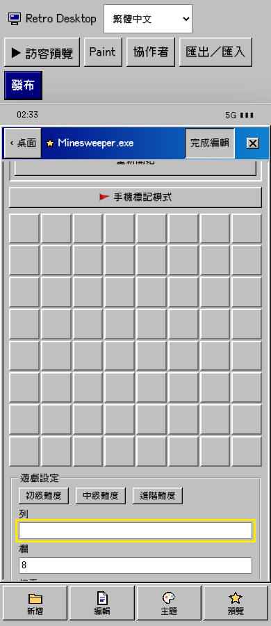
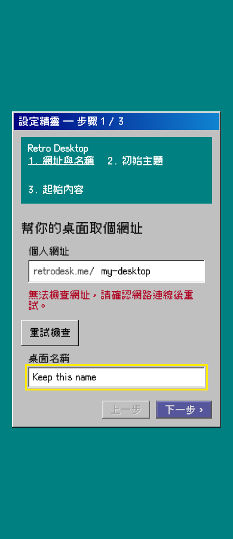

# F09/F10 focused verification

Base: `f11ad8d5cb869d47849834cdd8a692a5059d8021` (remote main at worktree creation). Scope: [audit F09/F10](https://github.com/laiw54724-ui/retro/blob/a5a57ac90ee5ec8d3fe82709f2a9aad1b1c3bcf5/docs/quality/ux-audit-2026-10-19/README.md).

## Reproduction before changes

- F09: the 320px browser assertion expecting an empty row input failed with actual value `5`. This was the real inline editor on main, with the draft-save endpoint intercepted.
- F10: the 390px availability request was aborted; the browser snapshot retained `正在檢查...` after the request failure and no Retry action existed. The assertion for Retry failed after five seconds.
- The existing normalized-name early return from #117 was already present and is retained. Its existing regression test passes.
- One initial combined reproduction attempt lost its local Vite server between cases; the URL reproduction was rerun on a dedicated server. No product conclusion relies on that connection-refused failure.

## Behavior

Minesweeper keeps string drafts until blur or Enter. Empty, fractional, and unsafe integer commits restore the current saved value. Complete integers clamp only on commit. Escape restores without saving or closing the window. No-op commits skip updates; changes from undo, redo, difficulty presets, or reduced cell count replace obsolete drafts. Composition confirmation does not commit early.

Existing bounds remain rows/columns 5–12, mines 1–40, and fewer mines than cells. `0` remains visible while typing; committing it respects the existing minimum of 1. No schema was relaxed.

URL availability distinguishes idle, pending, available, taken, and failed. Failure has localized feedback and a 44px-high Retry button. Retry preserves the URL and desktop name. Pending and failed checks cannot enable Next. Input changes invalidate old requests immediately, and effect cleanup also prevents obsolete responses from updating the page.

## Verification

Environment: macOS, Chromium via Playwright 1.64.1, local Vite server on port 5326. All new browser cases use synthetic documents/auth and mock API endpoints; non-loopback requests are blocked. Touch/mobile assertions use browser emulation, not physical devices.

```sh
corepack pnpm install --frozen-lockfile
corepack pnpm --filter @retrodesk/web test:unit src/features/modules/minesweeper src/i18n/resources.test.ts
corepack pnpm --filter @retrodesk/web typecheck
corepack pnpm --filter @retrodesk/web build
PLAYWRIGHT_PORT=5326 corepack pnpm exec playwright test \
  tests/e2e/audit-f09-f10.spec.ts \
  tests/e2e/minesweeper-45.spec.ts \
  tests/e2e/editor-number-create-errors.spec.ts \
  --workers=2 --output=../evidence/final
```

This environment requires a `pnpm` shim on PATH for Playwright's webServer command (`exec corepack pnpm "$@"`). The dedicated server used `VITE_API_URL=http://127.0.0.1:5326 corepack pnpm --filter @retrodesk/web dev --host 127.0.0.1 --port 5326 --strictPort`.

- 23 unit/resource checks passed: parsing, empty/partial/unsafe integers, zero where allowed, static/dynamic bounds, gameplay, and translation parity.
- 21 browser cases passed: 11 new cases plus 10 existing regressions. Includes desktop and 320/390/430px numeric edits, touch blur, no premature saves, Enter/Escape, no-op saves, composition, undo/redo, presets, gameplay announcements, network failure/retry, repeated HTTP failures/retries, debounce, invalid names, and late success/taken/failure responses.
- Web typecheck and production build passed. Build emitted existing dependency annotation and large-chunk warnings.
- `git diff --check` passed.

Not run: full `verify:contributor`, native iOS/Android keyboards, WebKit/Firefox, live OAuth/API/storage, production/staging. This is a focused draft PR, not merge/deployment readiness. No changes to IG, MobileScreen, EditorPage, Paint, Image gates, flags, schema, or security policy.

## Synthetic fixture screenshots

The empty row remains editable while the board retains its saved dimensions:



The failed URL check preserves both fields and offers retry:


