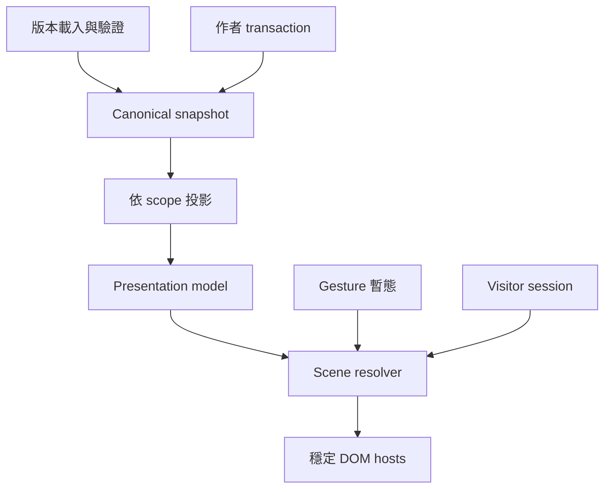

# Scene Builder 技術設計（Issue #54）

狀態：**待整合者審核的研究提案；沒有實作 Scene runtime 或 shared schema。**

- 調查日期：2026-10-17（Asia/Singapore）。
- 程式基準：`aa8b75a8a0b90ffc530b3b2d109804070f35d9d2`，已先 `git fetch origin`。
- 工作分支：`docs/retro-scene-builder-plan`，獨立 git worktree。
- 需求：[Issue #54](https://github.com/laiw54724-ui/retro/issues/54)。本文件是設計交付，**不以合併文件關閉 #54**。
- 配套：[分期驗收與實測紀錄](../plans/2026-10-17-scene-builder-acceptance.md)。

## 1. 建議與審核邊界

建議保留目前 React DOM 模組，新增一層有版本的 Scene presentation：**內容只有一份，desktop/mobile 各有有序版面樹；作者構圖、編輯暫態與訪客 session 分開**。Scene 控制位置、選取、圖層、群組與響應式呈現，App 繼續擁有內容和自己的互動。這些是依現有程式與 #54 作出的設計選擇，不是已存在的 API。

首個 runtime PR 前，整合者須核准下列契約。這份文件 PR 可先審核，不需要等待後續功能完成。

| 決策 | 本提案 | 核准／整合責任 |
| --- | --- | --- |
| D-01 版本與內容 | 顯式 `SiteDocumentV3`；保留頂層 `windows`／OC `entities`，Scene 是 geometry 唯一權威 | shared／API 整合者 |
| D-02 階層與層序 | 每畫布獨立 ordered placement tree；children 順序是唯一層序，不雙寫 parentId／zIndex | #54＋store 整合者 |
| D-03 訪客行為 | normal／fixed／decorative；normal focus 只在相鄰 normal 區段換序，不跨固定構圖 | #50 runtime 整合者 |
| D-04 群組 | 第一版只組 fixed／decorative；normal 留 root；無群組旋轉／合成濾鏡 | #54＋#49 |
| D-05 Mobile | 獨立構圖、等比縮放、自動排列；未設定與顯式沿用桌面有不同語意 | #54＋#41 |
| D-06 儲存 | canonical revision／load epoch 對應 save acknowledgement；reader 先上，server 禁止一般降版 save | store／API 整合者 |
| D-07 公開 | 明確 publish eligibility；全部 layout 設定與 shared node table 一起投影，之後才收集／複製素材 | shared／資產整合者 |
| D-08 外觀與行為 | #49 Chrome、#50 UiAction、#51 image、#41 presentation model 共用；不各做一套 | 各 Issue owner＋整合者 |

本次新增兩份 Markdown 與一個文件檢查程式；不改 `apps/`、`packages/`、runtime 測試、registry、store、CSS、lockfile 或 SQL。未來需要改共享檔案時，先把 D-01～D-08 與檔案責任表交給整合者，再另開契約 PR。

## 2. 最新需求、PR 與程式證據

### 2.1 Issue／PR 快照

已讀 #54、直接依賴 #49／#50／#51 及其留言（調查時四張皆無留言），並讀 #29／#35／#36／#41。

| 項目 | 調查時狀態 | 對本案的影響 |
| --- | --- | --- |
| [#49 WindowChrome](https://github.com/laiw54724-ui/retro/issues/49) | Open；W1a/W1b/W1c 為待做階段 | slots、拖曳手柄、frame metrics、控制 capability 穩定後再接 Scene |
| [#50 UiAction](https://github.com/laiw54724-ui/retro/issues/50) | Open | session dispatcher、modal、typed failure 是共同邊界 |
| [#51 Image](https://github.com/laiw54724-ui/retro/issues/51) | Open | 圖片資料只存於 image module，不建立 Scene 專用圖片 schema |
| [PR #38](https://github.com/laiw54724-ui/retro/pull/38) | Open Draft；head `d47e798bd6cc5bff8f8776748be663b32b058332` | 共用 title appearance resolver，尚未包含於本次 main |
| [PR #47](https://github.com/laiw54724-ui/retro/pull/47) | Open Draft；head `653357373e28dac518d7cb522b497c70cc2e2bc3` | Gallery 焦點返回、OC 輸入穩定性、Moodboard／手機掃雷修正；不能被 Scene 事件層覆蓋 |
| [PR #48](https://github.com/laiw54724-ui/retro/pull/48) | 已合併，merge 即本次基準 | focus scrim、catalog 捲動要保留；不沿用它的巨大 z 數字當 Scene 契約 |
| [#41 presentation](https://github.com/laiw54724-ui/retro/issues/41) | Open | 補齊草稿／公開 OC presentation parity；Scene 的各路徑須消費這份 model |
| [#29 navigation](https://github.com/laiw54724-ui/retro/issues/29) | Open | window／profile／post／music 目標與 stable IDs |
| [#35 appearance](https://github.com/laiw54724-ui/retro/issues/35)、[#36 templates](https://github.com/laiw54724-ui/retro/issues/36) | 後續契約仍待完成 | Appearance Template 不含節點、座標或 Scene Template |

PR 中的測試數字是作者回報；本研究自己的實測見配套文件，不把別的 PR 報告當本次 PASS。

### 2.2 現況與風險

下表的 repo 連結固定到已稽核 commit；「含義」是本次分析。

| 來源 | 已確認行為 | Scene 設計含義 |
| --- | --- | --- |
| [S01 RetroWindow](https://github.com/laiw54724-ui/retro/blob/aa8b75a8a0b90ffc530b3b2d109804070f35d9d2/apps/web/src/components/RetroWindow.tsx#L6-L85) | titlebar/body、三控制 callback；root 固定 dialog；geometry 由外層給 | #49 外框不應成為 scene store；裝飾不得繼承 dialog/focus 語意 |
| [S02 DesktopCanvas](https://github.com/laiw54724-ui/retro/blob/aa8b75a8a0b90ffc530b3b2d109804070f35d9d2/apps/web/src/features/editor/DesktopCanvas.tsx#L59-L138) | pointerdown 先 focus；client delta 直接套用；move 改暫態 DOM、up 寫 store | 已有暫態幾何基礎，但要補唯一座標轉換、cancel rollback 和 transaction ID |
| [S03 store](https://github.com/laiw54724-ui/retro/blob/aa8b75a8a0b90ffc530b3b2d109804070f35d9d2/apps/web/src/features/editor/store.ts#L75-L217) | focusWindow 改 persisted z；history 50 步、同 key 1200ms 合併；markSaved 比較 legacy | selection/focus 不能沿用 persisted reorder；Scene-only change 需要 canonical ack |
| [S04 VisitorDesktop](https://github.com/laiw54724-ui/retro/blob/aa8b75a8a0b90ffc530b3b2d109804070f35d9d2/apps/web/src/features/site/VisitorDesktop.tsx#L13-L225) | 本地 runtime open/min/max/rect；left/top 定位；初始化使用 defaultOpen | 訪客資料不可回寫作者；editor/visitor 座標與 max work area 要共用 |
| [S05 v1 layout](https://github.com/laiw54724-ui/retro/blob/aa8b75a8a0b90ffc530b3b2d109804070f35d9d2/packages/shared/src/site.ts#L57-L74) | desktop x/y/w/h/z/iconX/iconY；mobile 只有 order；z 1–9999 | Scene 要遷移 launcher 位置；目前沒有 mobile 自由幾何 |
| [S06 versioning](https://github.com/laiw54724-ui/retro/blob/aa8b75a8a0b90ffc530b3b2d109804070f35d9d2/packages/shared/src/site-versioning.ts#L147-L245) | v2 strict；canonical OC 與 legacy view adapter 分開 | 新 scene 不可偷偷塞 v2；view adapter 不能是儲存權威 |
| [S07 parse/migrate](https://github.com/laiw54724-ui/retro/blob/aa8b75a8a0b90ffc530b3b2d109804070f35d9d2/packages/shared/src/site-versioning.ts#L384-L538) | semantic refs、unsupported_version、v1→v2 deterministic IDs | 延續無損拒絕與 deterministic migration，不走 raw cast fallback |
| [S08 EditorPage](https://github.com/laiw54724-ui/retro/blob/aa8b75a8a0b90ffc530b3b2d109804070f35d9d2/apps/web/src/pages/EditorPage.tsx#L216-L310) | autosave 650ms／單一 in-flight、409 停止；未發布判斷只看 legacy；767px 切 mobile | Scene-only save/publish、mode-gated keyboard 與兩種 viewport 必須補 |
| [S09 PublicSitePage](https://github.com/laiw54724-ui/retro/blob/aa8b75a8a0b90ffc530b3b2d109804070f35d9d2/apps/web/src/pages/PublicSitePage.tsx#L28-L100) | v2 public projection／深連結／暫時 OC viewer；同時 mount desktop/mobile | 一次只掛載一份 live App；不能遺失 /oc 與 /post |
| [S10 Preview](https://github.com/laiw54724-ui/retro/blob/aa8b75a8a0b90ffc530b3b2d109804070f35d9d2/apps/web/src/features/editor/VisitorPreview.tsx#L1-L32)、[MobilePreview](https://github.com/laiw54724-ui/retro/blob/aa8b75a8a0b90ffc530b3b2d109804070f35d9d2/apps/web/src/features/editor/MobilePreview.tsx) | preview 只接受 legacy document；沒有完整 public OC model | #41 是接線前置；「目前草稿」和「可發布結果」需明示 |
| [S11 MobileScreen](https://github.com/laiw54724-ui/retro/blob/aa8b75a8a0b90ffc530b3b2d109804070f35d9d2/apps/web/src/features/site/MobileScreen.tsx#L45-L189) | 正式手機 editor/visitor 共用入口；icon grid＋單窗；cleanup stopAll | `MobileEditor.tsx` 是未接入主頁的舊實作，不以它為整合中心；media ownership 要收斂 |
| [S12 DraftViewer](https://github.com/laiw54724-ui/retro/blob/aa8b75a8a0b90ffc530b3b2d109804070f35d9d2/apps/web/src/features/collaboration/DraftViewer.tsx)、[access route](https://github.com/laiw54724-ui/retro/blob/aa8b75a8a0b90ffc530b3b2d109804070f35d9d2/apps/web/src/pages/CollaborativeSitePage.tsx) | viewer 只能看授權草稿，透過 private AssetSourceProvider | 共用 renderer 不代表各 scope 可互換權限 |
| [S13 publish API](https://github.com/laiw54724-ui/retro/blob/aa8b75a8a0b90ffc530b3b2d109804070f35d9d2/apps/api/src/routes/sites.ts#L139-L264) | CAS save；projection→copy assets→atomic publish→artifact | server 要另擋 schema 降級；維持 projection 先於素材複製 |
| [S14 public projection](https://github.com/laiw54724-ui/retro/blob/aa8b75a8a0b90ffc530b3b2d109804070f35d9d2/packages/shared/src/public-projection.ts#L37-L101) | 會修剪私有 OC、IG windows、music refs、Explorer branches | Scene nodes、全部 layout 設定、actions、labels 納入引用清理 |
| [S15 transfer](https://github.com/laiw54724-ui/retro/blob/aa8b75a8a0b90ffc530b3b2d109804070f35d9d2/packages/shared/src/site-transfer.ts#L5-L147) | JSON 匯入 2MiB；media manifest 按欄位 allowlist；v2 專用 remap 分支 | 新 visuals/actions 不能漏 manifest、scope 或 import preview |
| [S16 module boundary](https://github.com/laiw54724-ui/retro/blob/aa8b75a8a0b90ffc530b3b2d109804070f35d9d2/apps/web/src/features/modules/types.ts#L9-L85)、[WindowRenderer](https://github.com/laiw54724-ui/retro/blob/aa8b75a8a0b90ffc530b3b2d109804070f35d9d2/apps/web/src/features/site/WindowRenderer.tsx#L17-L75) | View／InlineEditor，主要依 editing/mobile booleans 與 callbacks | 需要明確 render mode/capabilities；Scene 不複製模組內容 |

其他已確認的缺口：pointercancel 目前只清 gesture ref，沒有還原已改的 DOM style；editor/visitor max 高度各保留 44/46px；EditorPage 衝突備份只複製 legacy JSON。這些是後續實作的驗收目標，本次沒有修改。

全域 CSS 在小螢幕隱藏 `.visitor-desktop`，preview 又可手動選 desktop；依程式推論存在明選 desktop artboard 仍被 CSS 隱藏的風險。**未以瀏覽器重現**，須在 W6a/W6c 以明確 artboard 選擇補驗，不能報為已重現 bug。

## 3. 架構與責任



| 層 | 擁有 | 不應擁有 |
| --- | --- | --- |
| Canonical document | windows、OC entities、visuals、scene nodes、artboard trees、合法外觀／互動資料 | selection、pointer、DOMRect、signed URL、正在播放時間 |
| Shared pure functions | 版本、scope、引用驗證、migration、projection、scene geometry／order resolver | DOM、Zustand、網路、session side effects |
| Editor session | selected node IDs、editingNodeId、artboard、pan/zoom、guides、gesture draft、clipboard | 第二份 App 內容 |
| Visitor session／#50 | open/min/max、active target、restore rect、session order、modal stack、媒體所有權 | canonical patch、autosave、作者 history |
| DOM presentation／#49/#51 | 穩定 App host、Chrome slots、image View、合法 appearance tokens | 自動遷移／儲存／改全域主題 |

新增檔案建議為 `packages/shared/src/scene.ts`、`scene-resolver.ts`、`scene-migration.ts` 及 `apps/web/src/features/scene/`。這些**只是後續路徑提案，現在不存在**；匯出、registry 和 store 的變更由整合者排程。

## 4. Canonical Scene 與 ID 契約

### 4.1 版本和唯一權威

採 `schemaVersion: 3`、內部 `scene.formatVersion: 1`。v3 保留 windows 內容定義與既有 OC entities；v3 window shape 不再接受作者直接修改 legacy `layout`。舊 View 需要的 layout 由 scene adapter 即時計算。不要持久化兩份可各自更動的 geometry。

**v3 scene 必填；v1/v2 缺 scene 走 adapter，不自動改檔。** 不接受「scene 缺省但 window layout 也已移除」的無位置文件。這讓 reader 可明確選擇版面權威，不需要同時調和兩套可寫 geometry。

### 4.2 節點、內容與 layout entry 分開

以下是概念契約，型別名與數值限制須在 W6a0 審核後落 shared，不可直接貼進 runtime 當已核准 schema。

```ts
type SceneNode = {
  id: NodeId;
  editorLabel: string;                 // 作者標籤；public 移除
  publication: "draft" | "published"; // eligibility，與畫布 hidden 不同
  behavior: VisitorBehavior;
} & (
  | { kind: "app-window"; windowId: WindowId }
  | { kind: "image"; windowId: ImageWindowId }
  | { kind: "visual"; visualId: VisualId }
  | { kind: "launcher"; windowId: WindowId }
);

type VisitorBehavior =
  | { mode: "normal"; visitorDraggable: boolean;
      visitorResizable: boolean; raiseOnFocus: boolean }
  | { mode: "fixed" }
  | { mode: "decorative" };

type Frame = { x: number; y: number; width: number; height: number; rotation: number };
// x/y 為同 artboard parent-local CSS pixels；非 device pixels。

type DesktopEntry =
  | { kind: "node"; nodeId: NodeId; frame: Frame; hidden: boolean; locked: boolean }
  | { kind: "group"; id: GroupId; editorLabel: string; frame: Frame;
      hidden: boolean; locked: boolean; children: DesktopEntry[] };

type MobilePresentation =
  | { mode: "inherit-desktop" }
  | { mode: "frame"; frame: Frame }
  | { mode: "full-width"; height: number | "aspect" }
  | { mode: "single-window" }
  | { mode: "hidden" };

type MobileEntry =
  | { kind: "node"; nodeId: NodeId; locked: boolean;
      presentation?: MobilePresentation }
  | { kind: "group"; id: GroupId; editorLabel: string; frame: Frame;
      hidden: boolean; locked: boolean; children: MobileEntry[] };

type MobileLayout = { children: MobileEntry[] };
type SceneDocument = {
  formatVersion: 1;
  nodes: SceneNode[];
  desktop: { width: number; height: number; children: DesktopEntry[] };
  mobile: { width: number; minHeight: number;
    activeStrategy: "independent" | "scale" | "auto";
    layouts: { independent: MobileLayout; auto: MobileLayout };
    scale: { hiddenNodeIds: NodeId[] } };
};
```

`mobile.layouts` 保存 independent、auto 兩份**版面樹**，只重用 nodeId，不複製 App／OC／圖片內容；scale 只保存 hiddenNodeIds，位置、群組和順位直接繼承 desktop，沒有另一棵排序鏡像。只有 activeStrategy 對應的有效 tree 參與 render；切策略不刪除另外的設定。兩份樹及scale設定都須結構、引用、scope、安全驗證和 public pruning；不能以「inactive」當作未驗證的資料藏匿處。首次建立時由 adapter 產生最小設定；禁止另外雙寫 parentId／zIndex 權威。

圖片節點只指向 #51 image window：source、asset reference、alt、caption、crop、GIF、frameMode 由 #51 持有。`visuals` 僅新增 plain text／既有合法 icon ID／有限 enum shape，不新增另一種 image source 或 arbitrary CSS。文字與 icon payload 是使用者內容，不交 i18n 自動翻譯。

v3 每個 window 在 scene.nodes 中**恰好一個** app-window/image identity node（可尚未放置），其 publication 同時是該 window 內容的公開資格；可有多個 launcher 指向同 window。每個保存的 tree 對同 nodeId 至多一個 leaf；scale 繼承 desktop 唯一 placement。刪除展示位置可讓同 node 留在另一畫布；移除所有 placements 的 App 留在作者未放置清單，不把 window 變成沒有公開資格來源的孤兒。公開投影不送出無公開入口／引用的 node；published 且被合法 action 引用的未放置 App 可保留 definition，執行時若當前畫布沒有 presentation，回 unavailablePresentation，不偷偷創建作者節點。

刪除 desktop placement 前，若其他 mobile tree 的 inherit 依賴它，先將當前 resolved rect materialize 為獨立 frame（auto 則保留有效 flow/group geometry），同一 transaction 後才能移除；受影響的 locked placement 會阻止整次操作。新 mobile-only node 直接使用 frame／flow，不能產生沒有 desktop 來源的 inherit。scale 不顯示 desktop 中不存在的 node。

GroupId 只識別版面群組；group 不持有 App 內容。children array 是 hierarchy 與 sibling order 唯一來源，parentMap、depth-first paint rank 均衍生。NodeId、WindowId、VisualId、GroupId 和 entity ref 用不同 typed namespace，不能拿標題／array index／DOM id 當關聯鍵。

### 4.3 建議限制與 migration 例外

| 項目 | W6a0 建議值／規則 | 理由 |
| --- | --- | --- |
| Windows | 保留目前最多 100 | 不因 Scene migration 縮減舊站容量 |
| Scene leaves | 最多 256；50 起顯示效能提示 | 舊站 100 App＋100 launcher 已是 200，不能直接 cap 100 而無法遷移 |
| Groups | 每個 layout 最多 64；深度最多 8 | 限制循環／遞迴／操作成本 |
| Artboard | desktop 新建預設 1280×800；mobile 390，初始最小高 844；最大邊 16384 | 是提案值，須以 W6d 數據調整 |
| Geometry | finite；x/y 絕對值 ≤32768；width/height >0 且 ≤16384 | 拒絕 NaN/Infinity／極端 CSS layout |
| 模組尺寸 | 舊一般 window 220–1400 × 140–1200 相容；新 min/max 由合法 module capability 提供 | 圖片／decorative 不能硬套 220px 最小寬 |
| 字串／shape | label ≤120、plain text ≤4000；有限 shape／style tokens | 不開 expression、HTML、任意 style 字串 |
| 全文件 | 與既有 import 2MiB、API body limit 一起驗證；本案不自行提高 | 防止 save 成功但 export/import 不可恢復 |

超出新 limits 的合法 legacy 文件：繼續可用原 adapter 讀取，Scene 升級回傳有路徑的 diagnostics；**不靜默 clamp、不刪節點、不自動保存縮減版**。數量限制不等於可保證同時播放 256 個 GIF；實際掛載预算另驗。

Kind/capability驗證：app-window只允normal/fixed；visual只允fixed/decorative；launcher是可聚焦的fixed入口，不能設decorative或normal。image的behavior須與#51 interactionMode一致。App、launcher、group與有Image Viewer/Paint Chrome的image，rotation必為0；plain visual及無框/簡框的decorative image可用有限[-180,180]角度。旋轉以border-box中心為origin，先轉local shape再平移到parent；AABB不含陰影或selection outline。不合法組合回diagnostic，不忽略欄位後另存。

## 5. DOM host、座標與視窗外框

### 5.1 純函式 resolver

共用 `resolveScene(presentationModel, artboard, viewport, session, gestureDraft)`，輸出 stable node list、world frames、paint rank、effective visibility/lock、frame/action capabilities、diagnostics。同一輸入必須 deterministic，不能讀 editor store／window.innerWidth／Date.now。Viewport 尺寸是明確輸入，不是隱含全域。

座標分為 client、viewport-local、artboard world、parent-local。先以容器 client rect 扣 offset，再用 viewport pan/zoom 的 inverse 轉 world，再用 parent inverse 得 local。`devicePixelRatio` 不再乘進 CSS pixels。Gesture 開始凍結矩陣與起點；page scroll／容器 resize／artboard 切換若改變矩陣，首版取消操作並恢復，不用舊矩陣繼續拖。

拖曳縮放的視覺回饋用 transient style/ref 或局部 external store，每 frame 最多一次 requestAnimationFrame；canonical、history、autosave 只看 commit。Snap 預設沿用 8px；guide tolerance 定為 6 client px，先除 viewport scale，不隨 zoom 變得忽大忽小。數值輸入和 keyboard nudge 使用同一 geometry command。

### 5.2 穩定 DOM host

`SceneSurface` 是未 transform 的 viewport 容器，設自身 stacking isolation。葉節點以固定 parent、固定 key/host 成為 siblings；各 host 套 world→viewport 的 translate/scale，visual 另加合法 rotation。Group 只由 resolver 算 world boxes 與連續 rank，不建立會縮放 App 的 CSS group wrapper。

編輯器 canvas zoom 會縮放整個觀看座標，這與**作者 resize App**不同：後者修改 width/height，讓 App 重新排版，不能改文字大小假装元件已 resize。正常與最大化之間保留同一 host、同一 live module instance；max 改用 viewport work-area rect，移除該 host 的 canvas scale，restore 回原 frame/run/order。不要靠更換 React portal parent 達成 max 而重置音樂／IG session。

CSS transform 會建立 stacking context 並影響 containing block，因此 module-local overlay 留在 module scope；全視窗 modal 使用明確 session overlay host，位於變換區域之外。這是依 [W3C CSS Transforms](https://www.w3.org/TR/css-transforms-1/#transform-rendering) 作出的容器設計；不能只把 zIndex 寫到很大就保證越過父 stacking context。

### 5.3 #49 對接契約

Scene 提供 geometry、active、mode、effective capabilities 和 drag/resize handle props。#49 提供 chrome slots、frame insets、最小可用尺寸、work-area metrics 與合法控制組合；titlebar handle 使用顯式 ref/props，不以 `.retro-titlebar` selector 充當永久 API。

Chrome role 要能表達 interactive window／region／decorative，無框 image 不產生假的 dialog。Appearance 只使用 #35/#38 resolver 的 scoped tokens；Scene 不重算標題文字色、不新增第二套手機 titlebar。沒有的 slot 不留空白。

## 6. 層序、fixed 構圖與訪客行為

作者持久化層序＝layout children 順序：children[0]最背、最後一項最前；依index遞增DFS為每個葉分配密集paint rank。focus/selection不修改樹；「前移／後移／置頂／置底」才是作者transaction。Group是連續的視覺block，子節點不與外層sibling交錯。

| 行為 | 幾何／層序 | 真 App 內容 | 控制與入口 |
| --- | --- | --- | --- |
| normal | 依設定可 session 拖／resize；focus 依設定只在同一 normal 區段置頂 | 可操作 | 經 #49/#50 的 close/min/max；taskbar、launcher |
| fixed | authored rect 與 paint rank 不因訪客改變；不是 CSS position:fixed | 可操作、可捲動 | 首版不提供移動/resize/max；close/min 亦不提供，保持固定構圖；需要可關閉的 Dialog 用 normal |
| decorative | 位置與順位固定，pointer-through | 純視覺；不 dispatch actions | 無 tab stop、無 taskbar、空 alt 或 aria-hidden；editor overlay 仍可選取 |

Fixed/decorative 的語意由 dispatcher 再驗證，不能只隱藏按鈕。App 按鈕、音樂、導航仍可在 fixed 內使用；「locked」只限制作者版面修改，不停用 App 內容。

**Barrier 決策：** root 的每個 fixed／decorative／group 都切斷 normal run。例：`[normal A, normal B, fixed C, normal D]` 中 focus A 得 `[B,A,C,D]`；不能變 `[B,C,D,A]`。全是 normal 的舊桌面仍可正常置頂。這比只有「不提高 fixed 自己的 z」更能保留重疊構圖，但 normal 被前景遮住時 focus 不保證完全可见；UI 用既有明確最大化提供閱讀入口，不暗中改成 solo 或跨 barrier。

Max 使用 viewport work area（扣 taskbar、安全區與 Chrome frame margins），不是 group 百分比。正常→max→restore 不改 canonical，且同一 host 不重掛；runtime max 顯示在 scene 上方、taskbar 和 modal 下方。Desktop/mobile work area 由同一 metrics resolver 提供。

Runtime restore rect以active artboard world CSS px保存；normal drag/resize經host inverse取得同單位。max與single-window rect用viewport CSS px，只是顯示override，不能回寫restore rect或canonical frame。

建議區層為 background → authored scene → runtime max → editor guides/selection → taskbar/start → session modal → editor preview shell。實際 z 值為 scoped constants，與作者 rank 分開；App-local lightbox 不自行升格全頁 modal。PR #48 focus scrim 只在明確 content-edit isolation 中使用，不能把 Scene layout 模式的選取 node 自動拉到頂層。

## 7. 選取、鎖定與事件模式

### 7.1 狀態與 UI

左側維持 Apps／Visual／Windows 三分類與搜尋，新增與圖層清單分開；Inspector 四分頁為內容／樣式／互動／版面。元件內容編輯交既有 InlineEditor；Scene 的基本層只放選取、拖、尺寸、前後、鎖定、手機顯示，群組／對齊／精確座標在進階。

| Mode | Pointer／keyboard | 可用寫入 capability |
| --- | --- | --- |
| select/layout | 點擊＝選取；Shift 多選；空白處框選；圖層清單可選被遮物件 | 只有 Scene commands；App View inert、外層 selection overlay |
| content-edit | 只有一個 editingNodeId 的 InlineEditor 接收輸入；geometry handles 不搶表單 pointer | 指定 site/node/content revision 的 App mutation channel |
| preview-current-draft | 可操作授權草稿的訪客 session，明示未發布內容 | 無作者 mutation；背景 editor suspend/inert |
| preview-publishable／visitor | 以公開投影 model 執行 #50 actions | 無作者 mutation；只有 session／既有授權的訪客功能 |

Pointer overlay 不能阻止 keyboard tab 或 iframe 內焦點；select mode 同時使用 inert 與外部選取機制，圖層清單保持可及。`inert` 會阻止內容被聚焦並移出輔助技術操作面，[HTML Standard](https://html.spec.whatwg.org/multipage/interaction.html#inert) 是這個模式隔離的依據。不能只用 pointer-events:none 就宣稱裝飾內的按鈕不會被鍵盤碰到。

selection 只存 NodeId 集合＋primaryId，group selection 存 layout group identity。框選以 world bounds 相交為準，旋轉圖形第一版使用可見 bounding box，規則在工具說明標示。hidden／locked 預設不被框選或 pointer hit；可在 Layers 選到並看原因／解鎖。多選同時包含 parent 與 descendant 時正規化為最上層 entry，不能 double-apply delta。

Lock 為每 layout entry，ancestor lock 向下傳播；禁止移動、resize、rotation、reorder、group、delete、改手機 presentation，允許檢視、明確解鎖與內容編輯。跨畫布 copy/delete node 若影響 locked placement，先回報受影響畫布並阻止，不偷解除。hidden 是持久化版面顯示；暫時關閉/minimize/content-edit isolation 是 editor session，不混用同一 checkbox。

Lock保護受鎖entry的world geometry、visibility與作者層序。command先求受影響closure；未鎖parent若包含locked descendant，也不能藉group move/resize/reparent/hide繞過。貼入locked group或跨過locked layer的作者reorder須阻止；刪除無關sibling後dense rank重新編號不算改變受鎖物件的相對順位。解除鎖定是獨立、明示、可undo的操作。

### 7.2 Pointer transaction

1. pointerdown 綁定 `{siteId, loadEpoch, artboard, strategy, pointerId, entryIds, localRevision, beforeFrames, inverseMatrices}`；滑鼠僅 primary button，觸控/筆只接受正在操作的 pointer。
2. 超過起拖門檻後 capture pointer；rAF 更新 gesture draft。選取改變、active、guides 不寫 canonical。
3. pointerup 計算最後有效幾何、validate 全組、原子 commit；沒有實質位移是 no-op，不加 history／autosave。
4. pointercancel、lostpointercapture、Escape、切 site/artboard/mode、target 被刪、viewport matrix 改變或第二 pointer 介入：abort，恢復起點，釋放 capture，不 commit。正常 pointerup 後的 lost capture 不二次取消已完成操作。
5. 長拖 5 秒也只有一個 transaction。keyboard autorepeat 從首 keydown 至 keyup/blur 為一筆；不借用 1200ms typing 合併來近似一次拖曳。

[W3C Pointer Events](https://www.w3.org/TR/pointerevents3/#pointercapture) 定義 capture 及 cancel/up 後的釋放；這裡的 transaction/rollback 是本案額外設計。`touch-action:none` 只放手柄、選取覆蓋區與平移工具，互動 App 內容保留原生捲動／range／Paint pointer。兩指平移首版在明確 Pan 工具使用；一般 App 不搶瀏覽器 pinch zoom。

Ctrl/Cmd-Z、方向鍵、Delete、Space-pan 必須檢查 active editor session、mode、`isComposing`、`defaultPrevented` 與 `target.closest(input/textarea/select/contenteditable/role=textbox)`。Preview 開著時不能 undo 背景草稿。Escape 先交正在操作的表單／module modal，再交 #50 modal、gesture cancel、deselect；不得一鍵同時關三層。

手機／键盤另有數值輸入、1px/Shift 10px nudge、上移/下移圖層按鈕和明確「選取／移動」工具。觸控目標建議至少 44px；這是本案 UX 目標，非宣稱既有所有控制已達標。200% 瀏覽器 zoom、IME 組字和螢幕閱讀器另驗。

## 8. 群組、對齊與複製

### 8.1 群組語意

各畫布及 mobile strategy tree 的 group 可以不同，內容 nodeId 仍共享。第一版只允許同 parent、連續 siblings、fixed/decorative entries 成組。選到非連續 siblings 時明確阻止並提示先排序；不偷偷把夾在中間的視窗移走。未來可加 reorder preview，不能把其行為默認到 W6b。

group frame 的 x/y 是 parent-local 平移；width/height 是編輯 bounds，**不會自動 CSS scale children**。group、ungroup、reparent 先求 world frames，再轉到新 parent-local，保留外觀位置與子層順序，一個 undo transaction。child 增減後若重算 group bounds，須同步補償 child local offset；public projection 不做這個整理，避免刪 private child 造成公開子節點跳位。

Group resize用起始bounds計算scale，更新所有descendants的local offsets、nested group width/height與leaf boxes；先由全部leaf的min/max求可行scale區間，再整組clamp或拒絕，不能各leaf任意clamp。App使用新width/height重新layout。Group rotation固定0；visual leaf可在W6b支援rotation。含旋轉leaf的group初版只允許等比resize，避免非等比affine shear無法以純Frame無損表示。

無 group opacity、filter、clip、blend、perspective；對 children 分別套 opacity 不等於真正合成群組。Groups 不增加獨立 runtime App，也沒有 taskbar entry。

全域 behavior 從 fixed 改 normal 要驗證所有保存的 layout trees；若仍在 group，阻止並列出需要解組的畫布／策略，不偷偷改另一張構圖。作者可另外執行有預覽的多樹 reparent transaction。

### 8.2 對齊、分布、snap

只操作當前畫布同 parent 的 unlocked selection；不同 parent 先明確移到同層。左/中/右與上/中/下相對 selection bounds；平均分布按外緣之間的間距，至少三項，不改前後次序。對齊可見 world bounds，旋轉圖形使用 AABB；snap 對象為可見 unlocked sibling、artboard 邊界與中心，鎖定物件可當參考但不跟著移。

### 8.3 Duplicate、clipboard 與 delete

一般「複製選取物件」建立新 scene node IDs；App/image 同時用對應 module duplication contract 建新 window definition，但 OC profile/post 與原始 image asset 可依既有內容模型共享，不深拷另一套角色。保持每個 window 一個 live scene instance 的限制。只想多個入口時用「建立捷徑」，新增 launcher，不複製 live App。這兩個動作在 UI 明確區分。

內部複製先建完整 ID map，再 remap group children、內部 node/window/action refs；外部 targets 保留原 stable ref。本地 clipboard 用帶 formatVersion 的 typed selection package，不粘貼任意 HTML／CSS／JS。跨站 paste 重新驗 site scope 與素材權限，不能把原站 private asset reference 當新站可用；沒有可搬移素材就回報缺件。

一般duplicate也配置新VisualId並複製plain text/icon/shape payload，修改複本不影響原本。若原selection多node共用同visual，以ID map保留「複本內共用」，但不共用回原visual；只有未來明確的共用元件功能才可採其他語意。

刪除分為：移除此畫布 placement、移除此 scene node 的全部 placements、刪除 App definition、解散 group、刪 group 及其展示子項。移除 App 的全部 placements 仍保留 identity node與window在未放置清單；真正刪除App才原子刪除這對definition。visual/launcher node則可在清理所有引用後移除。App definition 的刪除先列出 scene、launcher、#29 links、#50 actions、Explorer references，再阻止／重指定／一次 cascade。共用 OC entities 不因刪 window 被刪除；asset bytes 不隨 node delete 自動刪除，保留 undo 可恢復性。

## 9. Desktop／Mobile 雙畫布

### 9.1 裝置與 artboard 分開

`activeArtboard` 是作者／預覽者選擇；實體 viewport 是容器尺寸。手機可明選 desktop artboard 並 Fit／Pan；桌機可編 mobile。CSS @media 只能調編輯器外殼和觸控工具，不可把明選的 artboard display:none。公開頁依實體 viewport 選 mobile/desktop；預設 break point 沿用 767/768px，但明確傳給 resolver。

獨立手機畫布推薦用 390 CSS px 設計；公開 viewport 窄於設計寬時，absolute scene 用 fit transform，root full-width／single-window UI 以實際 usable width reflow，overlay coordinates 必須反映兩者。320px 若閱讀過小，提供已定義的 full-width／單窗入口，不宣稱等比例縮小自然可用。

Resolver逐host輸出`coordinateSpace`、matrix/inverse與contentScale。例：designWidth=390、viewport=320、gutter=12時，absolute x=100/w=100解析為x≈82.05/w≈82.05；full-width則x=12/w=296、contentScale=1，height=200仍是200個實際CSSpx。max/single-window也用viewport space。若viewport大於designWidth，absolute區域置中且不自動放大（scale=min(1,V/W)），root flow仍使用可用viewport寬度；editor額外的pan/zoom再統一套在這些resolved host上。hit-test和drag用各host的inverse，不能把full-width座標再除一次desktop/mobile fit scale。

### 9.2 三策略與五種覆寫

| 策略 | 未設定 presentation | 允許的明確覆寫 | 排版保證 |
| --- | --- | --- | --- |
| independent | 由 desktop world rect 比例投影的 derive-inherit | 五種全部 | frame 可刻意重疊；flow items 彼此不重疊 |
| scale | inherit-desktop | inherit-desktop、hidden | 等比映射桌面；任何局部 frame/full-width/單窗需先切 independent |
| auto | root App→single-window；visual/image→full-width；fixed/decorative group→整組 fit-width；明確加入的launcher→入口卡片 | full-width、single-window、hidden | 無 absolute mixed layout；同序單欄／入口格線，不重疊 |

表中的auto限制作用於root。auto group descendants僅允fixed/decorative的explicit frame或hidden，不允inherit；group root仍參與flow，整組fit是衍生觀看比例。作者可編輯group內local frames，但不能把group root改absolute。這是MobileEntry型別在不同tree/深度的semantic validation，避免auto群組沒有合法位置來源。

五種覆寫為：沿用桌面位置比例、手機獨立 frame、全寬、隱藏、App 單窗入口。undefined 是「由策略決定」，不可填成假 inherit-desktop，否則 auto 語意會錯。不同策略資料都保留，但當前操作只能產生當前策略合法模式；切換前提供有效構圖預覽。

五種是場景可表達的選項全集，還須與kind/behavior capability相交。decorative不得single-window或建立可聚焦入口；launcher只走入口卡片，不冒充live App；single-window限normal/fixed App且#50已有reader/navigation capability。缺capability時阻止設定並回diagnostic，不暗改behavior。fixed的單窗navigation規則見9.3。

independent 的 full-width／single-window 初版只在 root；想把 group child 改為這兩種時，先明確 reparent、保留 world rect，一筆 transaction。inherit-desktop 必須先解析 desktop **world** frame，再乘 `mobileDesignWidth / desktopDesignWidth`，最後轉為 mobile parent-local，不把 desktop local 值直接拿來用。

**避免 inherit 抵消群組移動：** 手機 group 拖／resize／reparent 前，在同一 transaction 中把仍 inherit 的 descendants 當前 resolved rect materialize 為 mobile frame，再操作 group。pointermove 僅暫態計算，取消不得 materialize。這樣 group 移動後 children 才會一起動，desktop tree 不變。

full-width 以 usable width 扣 safe gutter，image/visual group 按 aspect 求高；App 以合法指定高度與自己的 scroll model 呈現。flow 順序來自 active tree root children；single-window 入口連續段可按既有 3/4 欄配置。independent 中 absolute frames 不佔 flow 空間，和 flow 重疊是作者可見的構圖；editor 對遮住文字或入口給提示，不偷偷搬動。auto 禁止這種 mixed absolute 行為。

full-width的height=aspect只用已驗證的#51穩定尺寸/crop比例、保存的display frame比例，或auto group.frame的w/h；不能等網路decode後偷偷改flow，也不假設壞圖為1:1。plain text/App必須正數height，內容以可及的overflow/scroll呈現；若image缺可用比例，作者必須設明確height，非法舊輸入於public顯示固定placeholder/typed diagnostic。純resolver不讀DOM量文字自動高。含真App的auto fit group若在320px變得不可讀，必須有明確可聚焦的閱讀入口，或把該App轉root full-width/single-window後才可通過W6c；只驗無overflow不算完成。

scale不保存獨立tree，按desktop children展開，再移除desktop hidden及mobile.scale.hiddenNodeIds；缺值即inherit-desktop，UI的明確沿用動作只是清除此node的scale hidden override。不在scale提供重排／分組／mobile-only節點。刪desktop placement或node時同transaction修剪scale hiddenNodeIds；不可引用不存在的desktop node。independent/auto的hidden與locked只影響各自tree，不跟desktop同步；inherit只沿geometry，沒有desktop來源回diagnostic，不fallback到(0,0)或其他inactive tree。

auto 的 fixed/decorative group 由該策略保存的 tree 連續 fit-width，子節點只用 group 內幾何，不拆散；normal App 保持 root。初次由舊站轉auto，使用一個app/image node對應一個手機入口／全寬項目，不再把同window的desktop自動生成launcher加進去，避免双入口。作者明確新增的多launcher可以存在，但只產生入口，不掛第二份live App。切成 independent 時，將**當前有效** world frames materialize 成一份可編輯 tree；若已有 independent 設定，先選「恢復原構圖」或「以目前結果建立」，兩者都有單一 undo。

### 9.3 Hidden、single-window 與 public 的差別

hidden 不掛 DOM、不占 flow、不參與 hit-test；ancestor hidden 向下傳遞。hidden 不是 private，仍可能存在公開 JSON。mobile action 指向 hidden placement 時 #50 回 `unavailablePresentation`，不能自行復活它。若公開 OC 深連結指向可發布 entity 而沒有可呈現 node，可沿 #29/#41 建 session-only viewer；這不更動 scene 或作者內容。

single-window 是同一 App node 的手機閱讀 presentation：入口打開暫態 full-work-area viewer，back/close 回原入口並恢復 focus；不創建 canonical window。fixed App也可選這種呈現，但這是#29/#50的「進入／返回閱讀presentation」，不是對fixed節點dispatch maximizeWindow或closeWindow；返回只離開viewer，不改固定placement。入口與viewer不各掛一個App，保持單一instance。普通 mobile defaultOpen 沿用既有「先入口」語意，深連結與 character autoShow 才可直接進單窗；獨立 frame 構圖則按它的 authored placement 顯示。不要把 desktop 多個 defaultOpen 全轉成互相覆蓋的手機單窗。

Effective action capability取node behavior、module capability與presentation的交集：flow/full-width/single-window不能因normal.visitorDraggable而移動flow，只有可自由frame呈現的root normal可session drag/resize。多個launcher永遠focus同一target instance；合法window若無active placement或只有inactive設定，一般scene open/focus回unavailablePresentation，僅已公開entity深連結可走上文的暫態viewer。

safe-area、100dvh、軟鍵盤、landscape、scroll-to-focused-input 與 200% zoom 列入 W6c；不能只用固定 360×720 Preview 代表真機完成。

## 10. 共用預覽／公開 presentation 與生命週期

| 路徑／scope | 資料來源 | 必須保留的通道 |
| --- | --- | --- |
| Editor content | 授權 canonical draft | OC directory、profile/post refs、appearance、限定 mutation capabilities |
| Preview：目前草稿 | 捕捉同一 draft revision | 授權 private assets、所有作者可見內容、read-only session |
| Preview：可發布結果 | 相同 draft→正式 public projection | 被保留的 OC／node/action graph、同 scene resolver |
| Collaborator viewer | 授權 private draft | viewer 不得得到 edit callbacks；private AssetSourceProvider |
| Public／/oc／/post | immutable published snapshot | 公開 assets、siteHandle/share base、published target validation |

「可發布結果」與 public 使用同 projection/resolver，但 preview 不真的把素材複製到 R2；授權 provider 將 stable ref 解析為可預覽來源，public 使用已發布 URL。比對以 asset identity、model 結構、幾何與畫面為準，不能要求短效 URL 字串相等；preview 資料也不寫回 document。

Preview-current/publishable都不提供後端visitor-write capability：Guestbook送出等操作停用或只回本地示範結果，不能真的發送留言。Public才提供既有經權限驗證的訪客寫入能力；共同的View/resolver可相同，capability不能混用。URL、音訊和開窗仍可按#50的session測試規則操作。

一次 active surface 只 mount 一套 interactive DOM，不能沿 PublicSitePage 現況同時 mount 桌面／手機再 display:none。若將來並排兩畫布，第二張只能 passive preview／靜態 thumbnail，不可再 mount 音訊、iframe 或有 side-effect 的 View。

Live App 的 React key 使用 siteId、loadEpoch、surfaceSessionId、nodeId；snapshot revision只在session建立時記錄為來源metadata，**localRevision／save ack不放進React key**。Scene geometry commit、selection、Chrome preset與public pruning後順位改變都保持module instance；切site／preview purpose才建立新session。切artboard使用同一host owner切geometry/context，保留可恢復的navigation/form/game session，但停止media、不自動續播；關閉／最小化由#50與audioCoordinator定義一次，Scene不額外stopAll。不可讓inactive surface cleanup關掉另一session音樂。

Preview 開啟時，背景 editor inert 並暫停它的 runtime side effects／快捷鍵；不取消已經提交且正在儲存的作者 transaction。退出銷毀 preview session、停止其媒体，還原原 selection/artboard/viewport。音樂不自動重新播放。

## 11. History、autosave、協作與 async 安全

### 11.1 作者 command

建議 command 包含 operationId、siteId、loadEpoch、baseLocalRevision、active layout、affected IDs、before/after payload。Scene command 與 legacy module edit 最終都經同一 canonical reducer；legacy View adapter 只是衍生資料，不可藉 mergeLegacyDocumentIntoV2 把 scene 丟掉。

history 每步是一個 canonical before/after pair（維持先前 50 步上限，改上限另評估記憶體）。move／resize／group／multi-delete／mobile strategy switch 一次一筆；view state 不進 history。undo/redo 清理不存在的 selection，產生新 localRevision、讓 autosave 存恢復結果；不把舊 save ack 當作 undo 後已存。

### 11.2 Save acknowledgement

保留現有 650ms debounce＋單一 in-flight，但傳送捕捉的 immutable canonical snapshot 與 `{siteId, loadEpoch, localRevision, expectedVersion}`。ack 只有 site/epoch 相同才可更新 serverVersion；只有目前 localRevision／canonical fingerprint 與所送 snapshot 相同才標 saved。A pending、B scene-only edit 且 legacy unchanged 時，A ack 後 B 必須維持 dirty 並再存。只保留 revision 還不夠時，保存 exact lastSavedCanonical snapshot 供比對及備份。

publish button 的差異也改看 canonical；成功時記錄實際送去發布的 source revision／public projection，不把 request 等待期間的新草稿誤標 published。scene-only 變更要能保存、顯示尚未發布及發布。

server 既有 expectedVersion CAS 繼續使用；403/404 停止提交，409 暫停 autosave並保留本機完整 canonical。載入新站、reload、權限改變增加 loadEpoch，舊 response 不可污染新工作區。conflict backup 必須含 v3 scene 和所有 canonical entities；不只 copy legacy JSON。不加入 CRDT／多人游標，沿用文件級樂觀鎖。

In-flight guard也綁requestId；過期site/epoch response既不能更新version/status，也不能清掉新epoch另一個request的guard。

### 11.3 Async uploads／mutations

#43 媒體任務 callback 捕捉 siteId、loadEpoch、windowId/nodeId、field path、target generation／request token，不讀「目前選取的視窗」。完成時確認目標存在、版本/權限仍允許且未被 undo/delete/recreate；否則保留可重試結果並提示，不重建 node、不改別的視窗。undo 重建相同 ID 也要有新 generation，避免舊 upload 追上。

範圍只定 adapter 契約；Scene 不改 #43 upload task core，也不以 scene pointermove觸發 API。node delete 不自動刪 R2 bytes；資產垃圾回收須獨立考慮已存 draft、published snapshot、undo、pending task。

## 12. Migration、reader rollout 與 rollback

### 12.1 Legacy adapter／顯式升級

1. 純 parser 識別 v1/v2/v3；unknown version保留 raw、唯讀／可原樣備份，阻止 save。不要用 normalizeDocument 的 raw cast 作 v3 recovery。
2. v1 先走既有 deterministic v1→v2；v2→v3 另立純函式。reader 可先產 in-memory SceneProjection，**載入舊站不自動存 Scene**。
3. 每個 existing window 產穩定 live node與 launcher，保留 x/y/w/h、defaultOpen、iconX/iconY 和 mobile order；image 若 #51 已落地，引用同 image window，不能重新上傳。
4. Desktop 同 z 時按原 windows index 穩定 tie-break；保留原顯示顺序，不依不可控 UUID 排。launcher 放在原本 icon layer 相對位置，再形成 dense tree order。Mobile auto tree 按 order/index，普通 App為單窗入口。
5. Group 初始空；舊站一般 App normal、可用控制按原 capability；#51 decorative/frameMode 由已核准 adapter映射，不默認所有 image 都是裝飾。原手機 order只有順序，不能虛構已有獨立 mobile 座標。
6. 舊文檔沒有作者當時 viewport 尺寸。首次啟用 Scene 時顯示推算 artboard 預覽：至少1280×800並包住合理正向 extents；原 frame保留，不宣稱所有舊螢幕都像素完全相同。超限或不可達座標回 diagnostics由作者修正，不默移。
7. 確認啟用時先保留原始備份，用最新 expectedVersion作單次原子 v3 save。v3→v3 validation-only，不改 IDs、不注入未選 defaults；重跑 migration deterministic且不 mutate輸入。

### 12.2 必須掃描的讀者／寫者

不能只修改一個 Zod union。下列現有明確 `=== 2` 或 layout writer 都在啟用 v3 前處理：

| 區域 | 現有檔案 | Gate |
| --- | --- | --- |
| Parser／adapters | `packages/shared/src/site-versioning.ts`、`site.ts`、`index.ts` | 版本拒絕無損；legacy view projection不反向覆蓋Scene |
| OC operations | `social-operations.ts`、`collection-operations.ts`、`post-operations.ts`、`highlight-operations.ts` | v3 rich entities、CRUD／引用保護可用 |
| Public／SEO | `public-projection.ts`、`publish-checks.ts`、`public-metadata.ts` | graph完整；SEO／OC深連結不因version3失效 |
| Store／authoring | `store.ts`、`EditorPage.tsx`、`RightPanel.tsx`、`MobileScreen.tsx` | layout writer改command、canonical ack、backup/history |
| Transfer | `site-transfer.ts`、`apps/api/src/routes/transfer.ts`、`TransferDialog.tsx` | format、scope remap、media manifest、preview digest、2MiB |
| Save/publish/assets | `apps/api/src/routes/sites.ts`、`assets.ts`、`lib/publish.ts` | 降版 guard、projection先於素材copy、既有CAS |
| SQL readers | `supabase/migrations/0009_moderated_guestbook.sql` 的 published_document.windows讀者 | 保留頂層windows及guestbook語意；必要更動另開forward-only migration |
| Routes／render | PublicSitePage、DraftViewer、VisitorPreview、MobilePreview、WindowRenderer | 同scope-specific model、單active surface |

### 12.3 發布順序

| 順序 | 可啟用 | 不可提早啟用 |
| --- | --- | --- |
| R0 契約審核 | 本文件、fixtures清單、接口owner | runtime/schema變更 |
| R1 readers | v3 parse/project/metadata/transfer/render；v3 immutable fixture；仍只寫舊格式 | 真實用戶v3 save/migrate/publish |
| R2 server guards | 宣告可讀寫版本、既存v3拒收一般v1/v2 save、fresh CAS | 未支援v3的舊client覆寫 |
| R3 writer pilot | 選定開發/測試站顯式升級、Scene command、canonical ack | 無備份批次DB rewrite |
| R4 publish gate | public projection、assets、artifact、deep-link全部驗收後開v3 publish | 公開reader尚舊的情況發布v3 |
| R5 擴大 | W6b/c/d依階段開功能，觀察diagnostics/性能 | 宣稱文件PR已交付Scene |

server downgrade guard 需讀現有 draft schema，不能只比較 expectedVersion。舊client即使取得新版本號，也不得把v3投影成v2寫回。能力宣告欄位名、HTTP錯誤碼由API契約PR定義；本文建議 typed `unsupported_client_version`／`schema_downgrade_forbidden`，不宣稱現行已有。

### 12.4 Rollback

先關閉新 Scene writes／migration／publish flag，**保留能讀v3的API/web/metadata readers**。已存v3可唯讀及完整匯出；不能把「移除scene feature」等同部署只識別v2的reader。

若必須降到v2，另做明確工具：先完整v3備份、列出無法表示的decorations/groups/mobile/action資料、fresh expectedVersion後才轉換；不作loading fallback。公開回退使用先前可驗證snapshot產生新的published version，不能改舊artifact或倒退version counter。現有沒有通用restore endpoint；這是未來runbook要求，須由整合者在pilot前準備，不能在本文件聲稱已具備。

## 13. 公開投影、素材與資料安全

公私判斷以 node.publication、既有window/entity eligibility、目標可公開性及scope為準；layout.hidden、locked與editorLabel不賦予或撤銷資料權限。Group不另設private欄位，避免同一leaf因desktop與mobile祖先權限互相矛盾；要把群組設為草稿是一次修改其所有leaf publication，並明示跨畫布影響。

公開流程固定：

1. strict parse＋site scope＋完整引用圖驗證。
2. 先使用現有規則保留published entities；每個window再核對它唯一app/image identity node的publication及既有OC引用資格。identity為draft時，window內容、source/alt/caption/raw mirrors全不可公開，launcher/action/deep-link不得替它升權。公共OC entity的暫態viewer只能用已公開entity重建，不使用該draft window內容。
3. 移除 draft／引用不可公開content的scene nodes；移除它們在desktop及**所有mobile策略**的placements，清理launcher/actions的壞引用。不可把被刪target偷偷替換別的window。
4. 從eligible且保留的公開placements／launcher／allowlisted actions／合法入口建立可達keep-set，修剪不可達visuals、node records及window definitions（不只prune IG windows）。只有identity資格為published的App才可經引用保留definition；draft App/image＋published launcher/action的組合必須移除該引用，不能把私圖copy到public R2。未放置但作為合法公開target的App不預先mount。
5. 清掉editorLabel、作者縮圖/notes、layout.locked等editor-only metadata。**採獨立PublicSceneProjection型別**，允許缺少這些作者欄位；不以補假標籤來滿足author schema。
6. 保留存活group frame與child local frames；emptygroup刪除，single-childgroup保留，不能因pruning重新置中。檢查兩樹及inactive策略都沒有孤兒／私有payload。
7. 驗證public projection，才collectAssetReferences；asset的owner/site/object-key驗證與copy沿既有管線；rewrite immutable公開URL後再驗證，最後atomic publish與artifact。

Reader必須區分`AuthorSiteDocumentV3`與`PublishedSiteDocumentV3`的explicit schema/context。API draft/save只收author型別；immutable snapshot、public route、public export用published parser；projection接受已驗證published輸入時須idempotent，不能交回要求editorLabel/locked的author parser。把public export匯入成新draft是顯式import轉換：補上可推導的作者標籤、unlocked與合法publication預設，再驗完整author schema／新site scope。一般read不偷偷注入defaults。這項parser分流是R1/R4 gate，不能等公開後才修。

目前 [asset-reference walker](https://github.com/laiw54724-ui/retro/blob/aa8b75a8a0b90ffc530b3b2d109804070f35d9d2/packages/shared/src/asset-reference.ts#L24-L49) 遞迴掃stable refs；transfer manifest卻按欄位allowlist。#51 source、visual/action payload與raw authoring URL stripping都須加入typed traversal測試，不能因copy能找到asset就宣稱export manifest完整。

public export先projection再輸出；owner-backup保留全部scene與private節點，但原始素材bytes仍遵守既有「未包含」manifest。跨站duplicate/import改site scope、生成需要的新node/window/group/action IDs並驗ref graph，不復用來源站private權限。Appearance Template #36不含任何scene tree、座標或使用者內容；Scene Template後續獨立規格。

不開HTML/CSS/JS、expression evaluator、任意URL scheme、任意SVG、任意iframe HTML。形狀只接受有限numeric/enum/token；圖片/URL/actions沿 #51/#50現有allowlist。公開資料清理涵蓋payload、metadata、labels與asset-copy名單，不能只靠display:none。

## 14. 效能、可及性與依賴選型

沿用React、Zustand、Zod、Pointer Events；第一輪不新增canvas renderer、完整設計工具或拖曳套件。先抽pure geometry與command邊界，W6d若數據證實不足再比較套件；本研究沒有做外部套件benchmark，也沒有新增依賴。

優先避免重掛：geometry拖動不改App key，不把signed URL寫回，不因selection重啟GIF。hidden/offscreen重型App不應全部mount；不卸載正在播放、含未提交表單或無snapshot能力的App。lifecycle capability由module宣告可suspend/snapshot；#52播放器、#53 Paint加入時補實例驗證。先以合理上限＋Layers虛擬化/分頁處理大量節點，不為小量節點引入全局render memo複雜度。

GIF不是CSS animation，`animation:none`不能保證暫停圖片動畫；reduced-motion靜態poster／明確播放由#51提供。沒有poster可用時回報限制，不假稱已停。modal focus trap、Escape、focus return沿 #50；[WAI-ARIA Dialog Pattern](https://www.w3.org/WAI/ARIA/apg/patterns/dialog-modal/) 支持所需鍵盤與焦點行為，真正modal才標aria-modal。

W6d建議目標（非本次測量）：在記錄清楚的desktop/mobile測試設備，50/100節點分別量p50/p95 input-to-paint、拖曳frame time、long tasks、initial mount數／時間與peak memory；起始目標desktop p95 frame≤20ms、mobile≤33ms，超標縮減mount budget或功能範圍，再由整合者接受。所有report須含圖片/GIF/重型App比例、viewport、browser、device、CPU節流設定；不能只提供FPS數字。

## 15. 分期與衝突檔案

### 15.1 與 Issue 分期對齊

| 階段 | 可審核交付 | 進入条件 |
| --- | --- | --- |
| W6a0（新增前置子PR） | D-01～08契約、v3 readers、migration/projection fixtures、store/server guards | #49 W1a／#50 W2a／#51 W3a契約、#41model先協調 |
| W6a | App/image單選、拖/resize、層序、lock/hide；select/content/preview邊界；desktop parity | W6a0通過、#51image可用 |
| W6b | Layers、多選/框選、對齊/分布/snap、群組、visuals、duplicate/clipboard、nudge | W6a command/stable IDs已合併 |
| W6c | 三策略、五mobile覆寫、各樹隔離、normal/fixed/decorative完整visitor行為 | W6a先落behavior/resolver骨架，不能等W6c才處理focus/history |
| W6d | preview/public/transfer完整矩陣、50/100壓測、#52/#53真App fixtures | 實作範圍已可用；未落地App用標示清楚的fixture，不假称真功能 |

W6a採取了部分visitor behavior基础，以免之後把focus/store再次重寫；W6c仍負責完整手機與行為驗收。分期未完成的case在配套清單保持待執行。

### 15.2 檔案責任與衝突風險

以下均是**未來可能修改**，不包含於本次diff。

| 檔案／區域 | 衝突 | 依賴與分工 |
| --- | --- | --- |
| `packages/shared/src/site.ts`, `site-versioning.ts`, `index.ts` | 高 | #49/#50/#51/#29/#35；只由整合者排contract順序，#54不先占schema |
| `public-projection.ts`, `publish-checks.ts`, `site-transfer.ts`, `public-metadata.ts` | 高 | #41/#50/#51、資產／SEO；一同更新v3與ref graph |
| `apps/web/src/features/editor/store.ts`, `pages/EditorPage.tsx` | 高 | #43 async、#44 OC、#32 i18n與#54 command/history；分開可review commits |
| `components/RetroWindow.tsx`, 未來 `WindowChrome` | 高 | #49 owner；以props/handles adapter接入，等PR#38 resolver |
| `features/modules/registry.ts`, `types.ts`, `features/site/WindowRenderer.tsx` | 高 | #49/#50/#51/#44；統一capability，避免Scene專用第二registry |
| `DesktopCanvas.tsx`, `VisitorDesktop.tsx`, `DesktopTaskbar.tsx` | 高 | #50 session與#54geometry；保留#48scroll/scrim修正 |
| `MobileScreen.tsx`, `VisitorPreview.tsx`, `MobilePreview.tsx`, `DraftViewer.tsx`, `PublicSitePage.tsx` | 高 | #41presentation、#38appearance、#50navigation；明確一個active surface |
| `styles/w98.css`, `styles/global.css` | 高 | #49/#35/#32及既有layout；新Scene用scoped樣式，刪舊規則另review |
| `features/modules/*`，尤其image/gallery/music/instagram | 中～高 | #51/#43/#44/#52、PR#47；以既有module contract接，不批次改業務UI |
| `apps/api/src/routes/sites.ts`, `transfer.ts`, `assets.ts`, `lib/publish.ts` | 高 | CAS降版guard、projection/copy；先API相容再writer |
| `supabase/migrations/*` | 高（若需要） | 不改已部署migration；JSON scene原則無需新table，但SQL readers要驗 |
| `tests/e2e/editor-*.spec.ts`, `public*.spec.ts`, `responsive.spec.ts` | 中 | 避免多Agent共改一suite；Scene新增suite，既有endpoint計數修正另提交 |
| 本次三個docs檔 | 低 | 新檔且不改共享索引；main變動後重新查連結與範圍 |

實作前整合順序：PR#38→#49 W1a；#29/#41目標/model及#50 W2a穩定；#51 W3a穩定；#54 W6a0先把reader/projection/CAS/store契約審完，再接W6a UI。#52/#53不是W6a阻塞，但正式真App fixture需各owner配合。#32/#33只翻譯新增產品UI，不能翻譯作者OC內容。

## 16. 驗收索引、限制與審核問題

配套文件提供逐case的fixture、操作、oracle、phase與未來測試位置；本次文件檢查會驗證每個不變條件都有case，並檢查來源commit、local links與docs-only diff。**文件檢查不能證明Scene runtime正確。**

| 不變條件 | 說明 | Case |
| --- | --- | --- |
| INV-01 | DOM真App與單一內容來源 | SC-01, SC-02 |
| INV-02 | deterministic geometry、有限階層／層序 | SC-03, SC-04, SC-05, SC-06 |
| INV-03 | 作者構圖不被focus/session改寫 | SC-07, SC-08, SC-09 |
| INV-04 | 一次操作一次transaction、cancel無寫入 | SC-10, SC-11, SC-12 |
| INV-05 | mode/keyboard/pointer隔離、lock可預期 | SC-13, SC-14, SC-15 |
| INV-06 | group及duplicate/delete引用完整 | SC-16, SC-17, SC-18, SC-19 |
| INV-07 | mobile同內容獨立layout與策略 | SC-20, SC-21, SC-22, SC-23 |
| INV-08 | canonical save/publish/async version安全 | SC-24, SC-25, SC-26, SC-27 |
| INV-09 | migration/rollback無silent loss | SC-28, SC-29, SC-30 |
| INV-10 | public projection先於asset copy，transfer完整 | SC-31, SC-32, SC-33, SC-34 |
| INV-11 | route parity與單session lifecycle | SC-35, SC-36, SC-37 |
| INV-12 | 效能、可及性與真機證據 | SC-38, SC-39, SC-40 |

剩餘待審核項目：D-01～08尚未核准；#49/#50/#51/#41最終API可能不同；node/geometry limits與效能budget尚未benchmark；第一版群組不含normal且不能跨非連續siblings；scale/auto只接受限定mobile覆寫；沒有v3 restore操作工具；未做Safari/Android實機、視覺比較或Scene壓測。

本次95項基線單元測試和文件驗證，只支持「已讀路徑仍可測、設計與驗收對照完整、diff沒有越界」。它們不代表上述runtime功能已存在，也不代表已具部署條件。
